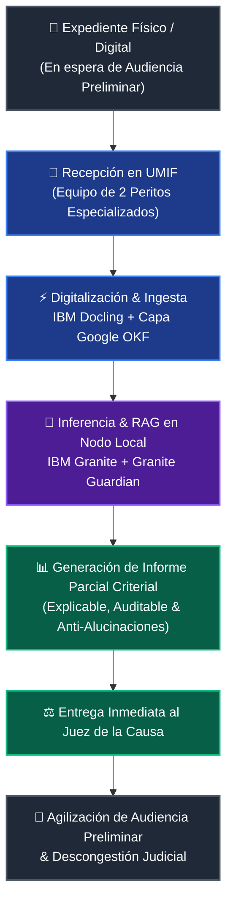
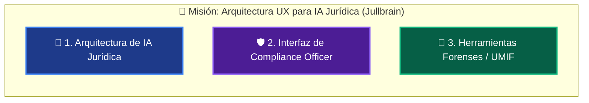

# 📜 ESTÁNDAR CANÓNICO DE ENCABEZADOS Y PROPUESTA DE PROYECTO
> **JULLBRAIN & UNIDAD MÓVIL DE INFORMÁTICA FORENSE (UMIF)**
> *Estándar de Metadatos Canónicos para Documentos Parseados por Docling, Marco Google OKF, Archivos `.bat`, Operación de Laboratorios Forenses Móviles y Perfil del Arquitecto LegalTech.*

---

## 🧭 Tabla de Contenidos (Navegación Rápida)

1. [💡 Idea Principal: Unidad Móvil de Informática Forense (UMIF)](#1--idea-principal-unidad-móvil-de-informática-forense-umif)
   - [1.1. Contexto y Problemática Social](#11-contexto-y-problemática-social)
   - [1.2. La Propuesta: Unidad Móvil (UMIF) + Nodo IA Local](#12-la-propuesta-unidad-móvil-umif--nodo-ia-local)
   - [1.3. Diagrama de Flujo Operativo (Workflow)](#13-diagrama-de-flujo-operativo-workflow)
   - [1.4. Impacto en la Administración de Justicia](#14-impacto-en-la-administración-de-justicia)
2. [🤖 Solución Tecnológica: IA de IBM (Granite & Guardian) + Marco Google OKF](#2--solución-tecnológica-ia-de-ibm-granite--guardian--marco-google-okf)
   - [2.1. Visión General de la Pila: Granite como Núcleo Indispensable](#21-visión-general-de-la-pila-granite-como-núcleo-indispensable)
   - [2.2. Componentes del Ecosistema IBM Granite en Jullbrain](#22-componentes-del-ecosistema-ibm-granite-en-jullbrain)
   - [2.3. Herramientas Complementarias Open-Source de IBM](#23-herramientas-complementarias-open-source-de-ibm)
   - [2.4. Marco Google Open Knowledge Format (OKF) + IBM Granite](#24-marco-google-open-knowledge-format-okf--ibm-granite)
   - [2.5. Arquitectura Híbrida Anti-Alucinación en 4 Pasos](#25-arquitectura-híbrida-anti-alucinación-en-4-pasos)
   - [2.6. Plataforma Enterprise SaaS (watsonx Cloud / Hybrid)](#26-plataforma-enterprise-saas-watsonx-cloud--hybrid)
3. [🎭 Rol y Perfil Profesional: Abogado - Diseñador UX/UI LegalTech & Forense Digital](#3--rol-y-perfil-profesional-abogado---diseñador-uxui-legaltech--forense-digital)
   - [3.1. Perfil Híbrido y Doble Formación](#31-perfil-híbrido-y-doble-formación)
   - [3.2. Tres Frentes de Acción Estratégica](#32-tres-frentes-de-acción-estratégica)
   - [3.3. Principios Rectores de Diseño LegalTech](#33-principios-rectores-de-diseño-legaltech)
4. [📌 Ficha Canónica del Proyecto y Datos Generales](#4--ficha-canónica-del-proyecto-y-datos-generales)
5. [📄 Encabezado Canónico para Documentos Docling & OKF (`YAML Frontmatter`)](#5--encabezado-canónico-para-documentos-docling--okf-yaml-frontmatter)
6. [🖥️ Encabezado Canónico para Archivos de Script Windows (`.bat`)](#6--encabezado-canónico-para-archivos-de-script-windows-bat)
7. [🔍 Parser e Identificador Canónico en Python (`parser_header_canonico.py`)](#7--parser-e-identificador-canónico-en-python-parser_header_canonicopy)

---

## 1. 💡 Idea Principal: Unidad Móvil de Informática Forense (UMIF)

> [!IMPORTANT]
> **PROPUESTA CENTRAL**: Implementar **Unidades Móviles de Informática Forense (UMIF)** equipadas con nodos de Inteligencia Artificial Local (Air-Gapped / Offline) impulsados por **Jullbrain** para la lectura, estructuración y síntesis acelerada de expedientes penales complejos.

### 1.1. Contexto y Problemática Social

```
┌────────────────────────────────────────────────────────────────────────┐
│                   DIAGNÓSTICO DEL RETARDO PROCESAL                     │
├────────────────────────────────────────────────────────────────────────┤
│  • Congestión Crítica en Tribunales Penales: Miles de expedientes.     │
│  • Detención Prolongada: Privados de libertad esperando audiencia.     │
│  • Cuello de Botella Analítico: Cientos de páginas por expediente.     │
│  • Riesgo de Corrupción: Falta de transparencia en la revisión.        │
└────────────────────────────────────────────────────────────────────────┘
```

En el sistema de justicia penal, una de las causas principales del **retardo procesal y la saturación carcelaria** es la acumulación masiva de causas pendientes por **Audiencia Preliminar**. Los expedientes físicos suelen constar de cientos de folios manuscritos, impresos o escaneados con baja calidad. Los jueces y secretarios carecen del tiempo material para analizar cada expediente de forma exhaustiva, lo que deriva en diferimientos continuos de audiencias.

---

### 1.2. La Propuesta: Unidad Móvil (UMIF) + Nodo IA Local

La **Unidad Móvil de Informática Forense (UMIF)** se concibe como un laboratorio pericial itinerante que se desplaza directamente a los circuitos judiciales o centros de procesamiento.

```
   ┌──────────────────────────────────────────────────────────────────┐
   │ 🚐 UNIDAD MÓVIL DE INFORMÁTICA FORENSE (UMIF)                    │
   ├──────────────────────────────────────────────────────────────────┤
   │  👥 EQUIPO HUMANO    : 2 Peritos Entrenados (TIC + Derecho IA)   │
   │  💻 NODO IA LOCAL    : Servidor RAG Offline / Air-Gapped        │
   │  ⚡ MOTOR DE PARSING  : IBM Docling + LegalProcessor v2          │
   │  🧠 MOTOR DE IA (LLM) : IBM Granite 3.0 + Granite Guardian      │
   │  📊 SALIDA ANALÍTICA : Informe Parcial Criterial para el Juez    │
   └──────────────────────────────────────────────────────────────────┘
```

#### Componentes Fundamentales:
1. **Equipo Humano de Peritaje (2 Especialistas)**:
   - **Perito Forense TIC / Operador de Ingesta**: Encargado de la digitalización segura, control de cadena de custodia digital y verificación de integridad criptográfica (SHA-256).
   - **Analista de Datos / Asistente Jurídico IA**: Encargado de supervisar la consulta RAG y validar los hallazgos normativos.
2. **Nodo Local de Inteligencia Artificial (Air-Gapped)**:
   - Unidad de cómputo portable que funciona sin conexión a Internet (garantizando confidencialidad e ISO/IEC 27001).
   - Equipada con **IBM Docling** para parsing OCR avanzado de expedientes.
   - Motor LLM **IBM Granite 3.0 / 3.1 / 3.2** con filtro de seguridad **Granite Guardian** para prevenir alucinaciones.
   - Base de datos vectorial con el cuerpo completo del Código Orgánico Procesal Penal, Código Penal, Constitución y jurisprudencia del Tribunal Supremo de Justicia en formato **Google OKF**.
3. **Informe Parcial de Análisis Criterial (IPAC)**:
   - Síntesis estructurada y neutral del expediente en 2 a 3 páginas.
   - Resumen de imputaciones, elementos de convicción aportados por las partes, cadena de custodia e hitos procesales.
   - Referencias directas a artículos y precedentes aplicables para que el Juez de Control evalúe rápidamente la admisión de la acusación.

---

### 1.3. Diagrama de Flujo Operativo (Workflow)



---

### 1.4. Impacto en la Administración de Justicia

> [!TIP]
> **BENEFICIOS CLAVE**:
> - ⏱️ **Reducción del Tiempo de Lectura**: Transforma 400 páginas de expediente en un resumen analítico verificado en menos de 15 minutos.
> - ⚖️ **Imparcialidad y Transparencia**: La IA resalta incongruencias procesales u omisiones sin emitir juicios de valor, respetando la potestad del Juez.
> - 🛡️ **Seguridad Criptográfica**: Cada expediente procesado se firma con un Hash SHA-256 para evitar alteraciones.
> - 🕊️ **Derechos Humanos**: Agiliza la revisión de causas de personas privadas de libertad sin juicio, garantizando el debido proceso.

---

## 2. 🤖 Solución Tecnológica: IA de IBM (Granite & Guardian) + Marco Google OKF

> [!IMPORTANT]
> **SOLUCIÓN ARQUITECTÓNICA AL RETARDO Y ALUCINACIONES**: Combinación del **Marco Google OKF** (Open Knowledge Format) para la estructuración estandarizada del conocimiento jurídico con la suite **IBM Granite** (Granite Text, Granite Embedding y Granite Guardian) para garantizar respuestas **100% auditables, trazables y libres de alucinaciones**.

### 2.1. Visión General de la Pila: Granite como Núcleo Indispensable

**IBM Granite** es el **motor central (*LLM Backbone*)** sobre el cual se articula toda la arquitectura de IA de **Jullbrain**. Google OKF provee la *estructura estandarizada del conocimiento*, e IBM Docling provee la *extracción pura de documentos*, pero **Granite es el cerebro que procesa, razona, sintetiza y audita las respuestas**.

La pila de IA se compone de dos vertientes complementarias:
1. **Pila Open Source / Gratuita (Local & Podman)**: Ejecutable sin costo de API mediante modelos de pesos abiertos (**Granite 3.0/3.1/3.2**, **Granite Guardian**, **Docling**, **InstructLab**, **Bee Agent Framework**, **Caikit**).
2. **Plataforma Enterprise SaaS / Híbrida**: Servicios gestionados cloud u on-premise (**watsonx.ai**, **watsonx.governance**, **Cloud Pak for Data**).

---

### 2.2. Componentes del Ecosistema IBM Granite en Jullbrain

```
┌────────────────────────────────────────────────────────────────────────┐
│                   ECOSISTEMA IBM GRANITE EN JULLBRAIN                  │
├────────────────────────────────────────────────────────────────────────┤
│ 🧠 Granite Text (3.0/3.1/3.2) : Cerebro Razonador (1B/3B/8B Apache 2.0)│
│ 📐 Granite Embedding         : Generación Vectorial Multilingüe       │
│ 🛡️ Granite Guardian          : Filtro Anti-Alucinación (Groundedness) │
│ 🧪 InstructLab               : Alineamiento de Dominio Legal          │
│ 🐝 Bee Agent Framework       : Orquestación de Agentes Autónomos      │
└────────────────────────────────────────────────────────────────────────┘
```

#### 2.2.1. Granite 3.0 / 3.1 / 3.2 (Text, Code & Vision) — El Cerebro Razonador
- **Modelos de Pesos Abiertos (Licencia Apache 2.0)**: Disponibles en 1B, 3B y 8B de parámetros para ejecuciones en Hugging Face, Ollama, vLLM o contenedores Podman en la unidad móvil (UMIF).
- **Función en el RAG**: Recibe los nodos **Google OKF** (frontmatter + Markdown) y el contexto vectorial. Comprende las estructuras YAML, sigue las instrucciones sin desviarse y genera explicaciones precisas en lenguaje natural o código.

#### 2.2.2. Granite Embedding — El Generador de Vectores RAG
- **Modelos de Pesos Abiertos (Apache 2.0)**: `granite-embedding-107m-multilingual`, `granite-embedding-278m-multilingual`.
- **Función en el RAG**: **Generación de embeddings vectoriales**. Convierte los textos y chunks de documentos a vectores de alta densidad multilingües para realizar la búsqueda semántica en la base de datos vectorial (Vector DB).

#### 2.2.3. Granite Guardian — Filtro Anti-Alucinaciones y Moderación de Seguridad
- **Función en el RAG**: **Indispensable para el control de calidad.** Granite Guardian es un modelo entrenado específicamente por IBM para realizar evaluación de *Groundedness* (verificación de respaldo empírico).
- **Proceso**: Compara la respuesta propuesta por Granite Text contra la fuente original (nodo OKF o chunk RAG). Si detecta que la respuesta contiene datos no respaldados o inventados (alucinaciones), la **bloquea o solicita intervención humana (*Human-in-the-Loop*)**.

#### 2.2.4. InstructLab + Granite — Alineamiento y Especialización de Dominio
- **Función**: Permite entrenar y adaptar los modelos Granite agregando conocimiento de dominio (ej. leyes, normativas, jurisprudencia, manuales técnicos) mediante taxonomías de conocimiento y síntesis de datos sintéticos.

#### 2.2.5. Bee Agent Framework + Granite — Orquestación de Agentes
- **Función**: Framework open-source que usa Granite por defecto como LLM autónomo para ejecutar herramientas, consultar la base OKF y mantener el flujo conversacional o de comandos.

---

### 2.3. Herramientas Complementarias Open-Source de IBM

- **IBM Docling** (`pip install docling` / `github.com/DS4SD/docling`): Convertidor de documentos (PDF, DOCX, HTML) a Markdown estructurado. Preserva tablas celda a celda, orden de lectura y expresiones matemáticas para alimentar el pipeline RAG y la capa OKF.
- **Caikit & KServe**: Runtimes de inferencia abiertos para desplegar modelos Granite en contenedores Podman o clústeres Kubernetes.

---

### 2.4. Marco Google Open Knowledge Format (OKF) + IBM Granite

#### 2.4.1. ¿Por qué se combina Google OKF con IBM Granite?
- **Google OKF** estandariza la estructura del conocimiento en la organización mediante archivos Markdown con frontmatter YAML (patrón *LLM-Wiki*).
- **IBM Granite** procesa esa estructura con precisión determinística y **Granite Guardian** valida que no existan alucinaciones en el output final entregado al juez.

#### 2.4.2. Estructura Canónica de un Documento OKF en Jullbrain

```markdown
---
type: legal_concept
title: Error Level Analysis (ELA) / Análisis de Integridad
description: Método forense algorítmico determinístico para detección de manipulación JPEG en expedientes.
normativa_aplicable: ISO/IEC 27037:2012 | COPP Art. 181
trust_signals:
  verified_by: "Laboratorio Forense sha256.us"
  reproducibility: "100% Determinístico"
relations:
  - type: depends_on
    target: jpeg_compression_grid
---

# Error Level Analysis (ELA)

El Análisis de Nivel de Error (ELA) resalta variaciones en la relación de compresión JPEG...
```

---

### 2.5. Arquitectura Híbrida Anti-Alucinación en 4 Pasos

```
                           ┌───────────────────────────┐
                           │   Documentos Complejos    │
                           │    (PDFs / Expedientes)   │
                           └─────────────┬─────────────┘
                                         │
                                         ▼
                               ┌───────────────────┐
                               │    IBM Docling    │ (Parser Open-Source: extrae
                               └─────────┬─────────┘  tablas, estructura, LaTeX)
                                         │
                   ┌─────────────────────┴─────────────────────┐
                   ▼                                           ▼
      ┌─────────────────────────┐                 ┌─────────────────────────┐
      │   Capa Google OKF       │                 │  Capa Vectorial RAG     │
      │ (Conocimiento Curado    │                 │  Granite Embedding      │
      │  Markdown + YAML Front) │                 │ (Vectores Multilingüe)  │
      └────────────┬────────────┘                 └────────────┬────────────┘
                   │                                           │
                   └─────────────────────┬─────────────────────┘
                                         │
                                         ▼
                              ┌─────────────────────┐
                              │   IBM Granite 3.0   │ (LLM Abierto: Razonamiento
                              └──────────┬──────────┘  y Síntesis de Respuestas)
                                         │
                                         ▼
                              ┌─────────────────────┐
                              │  Granite Guardian   │ (Filtro de Groundedness:
                              └──────────┬──────────┘  detecta y bloquea alucinación)
                                         │
                                         ▼
                              ┌─────────────────────┐
                              │  Respuesta Válida   │
                              │  y Auditable (XAI)  │
                              └─────────────────────┘
```

---

### 2.6. Plataforma Enterprise SaaS (Ecosistema IBM watsonx Cloud)

Cuando el usuario o la institución judicial requiera servicios gestionados en la nube IBM o despliegues híbridos:

- **watsonx.ai** — Servicio administrado para inferencia, fine-tuning y despliegue de modelos Granite y de terceros vía API.
- **watsonx Assistant** — Construcción de asistentes conversacionales de cara al operador judicial.
- **watsonx Orchestrate** — Automatización de agentes que ejecutan flujos de trabajo empresariales.
- **watsonx.governance** — Gobernanza corporativa, monitoreo de sesgo, deriva de modelo y cumplimiento regulatorio (EU AI Act, ISO/IEC 42001).
- **Cloud Pak for Data** — Plataforma híbrida/on-premise basada en Red Hat OpenShift.

---

## 3. 🎭 Rol y Perfil Profesional: Abogado - Diseñador UX/UI LegalTech & Forense Digital

> [!NOTE]
> **PERFIL PROFESIONAL HÍBRIDO**: **Jull Ortiz**  
> *Abogado-Diseñador UX/UI especializado en LegalTech & Forense Digital.*

```
┌────────────────────────────────────────────────────────────────────────┐
│                        DOBLE FORMACIÓN PROFESIONAL                     │
├────────────────────────────────────────────────────────────────────────┤
│ ⚖️  DERECHO           : Probatorio, Protección de Datos, Compliance, │
│                        Penal/Procesal aplicado a Evidencia Digital.   │
│ 🎨 DESIGN THINKING    : UX/UI Certificado IBM (Enterprise Design      │
│                        Thinking / IBM UX Design Professional).        │
└────────────────────────────────────────────────────────────────────────┘
```

### 3.1. Perfil Híbrido y Doble Formación

Un perfil profesional técnico-jurídico diseñado para cerrar la brecha entre la complejidad legal y la usabilidad tecnológica en entornos de **alto riesgo (*high-stakes UX*)**:

1. **Vertiente Legal & Probatoria**:
   - Abogado especializado en derecho probatorio, protección de datos (GDPR/LOPD), cumplimiento normativo (*compliance*) y derecho penal/procesal aplicado a la evidencia digital.
2. **Vertiente de Diseño UX/UI (Certificación IBM)**:
   - Diseñador UX/UI certificado por IBM (*IBM Enterprise Design Thinking / IBM UX Design Professional*), enfocado en la arquitectura de interfaces para sistemas complejos y usuarios técnicos y legales (jueces, fiscales, abogados, auditores y peritos).

---

### 3.2. Tres Frentes de Acción Estratégica



#### 1. Arquitectura de IA Jurídica
- **Flujos de Interacción Hombres-IA**: Diseñar experiencias fluidas entre el usuario (abogado, juez, fiscal) y los modelos de IA que analizan jurisprudencia, contratos o expedientes.
- **Explicabilidad (XAI)**: Garantizar que cada salida de la IA muestre explícitamente su fuente normativa, nivel de confianza y trazabilidad legal.
- **Human-in-the-Loop Obligatorio**: Diseñar salvaguardas e hitos de validación humana obligatorios antes de tomar o sugerir decisiones con efectos jurídicos.

#### 2. Interfaz de Compliance Officer
- **Dashboard de Control de Riesgo**: Monitoreo de riesgo normativo en tiempo real (AML, protección de datos, normativas sectoriales).
- **Alertas Priorizadas**: Clasificación dinámica por severidad legal y probabilidad de incumplimiento.
- **Logs Inmutables & Auditoría**: Registro de eventos inmutables orientados a preservar la cadena de custodia digital.
- **Reportes Probatorios**: Generación de informes exportables con plena validez probatoria.

#### 3. Herramientas Forenses y de Prueba Judicial (Evidencia Móvil / UMIF)
- **Visualización de Extracción Forense**: Interfaz para el análisis visual de metadatos, timestamps y hashes de integridad SHA-256 extraídos de dispositivos móviles.
- **Cadena de Custodia Visual**: Representación paso a paso de la preservación de la prueba, facilitando auditabilidad ante un tribunal.
- **UX de Reducción de Error Humano**: Presentación clara y accesible de evidencia digital compleja para jueces y operadores no técnicos, sin perder rigor científico-legal.

---

### 3.3. Principios Rectores de Diseño LegalTech

| Principio | Aplicación Práctica |
| :--- | :--- |
| ⚖️ **Legal-by-Design** | Cada pantalla e interacción contempla sus implicaciones probatorias y procesales antes que la estética superficial. |
| 🔗 **Trazabilidad Total** | Ningún dato o sugerencia se muestra sin poder demostrar documentalmente su origen (requisito de admisibilidad probatoria). |
| 🧠 **Reducción de Sesgo Cognitivo** | Evita que la interfaz o la IA "empujen" al juez o usuario a conclusiones prematuras sin suficiente respaldo probatorio. |
| 🌀 **IBM Design Thinking** | Metodología iterativa basada en el *Loop de Hills*, *Playbacks* y *Sponsor Users* con abogados, peritos y operadores judiciales reales. |
| 🛡️ **Cumplimiento Normativo Integrado** | Adherencia por diseño a GDPR/LOPD, ISO/IEC 27037 (Evidencia Digital), ISO 27001 y estándares forenses (NIST, SWGDE). |

---

## 4. 📌 Ficha Canónica del Proyecto y Datos Generales

| Parámetro | Definición Canónica |
| :--- | :--- |
| **Proyecto** | **Jullbrain & UMIF** *(Unidad Móvil de Informática Forense)* |
| **Idea Principal** | Ingesta, estructuración y vectorización de normativas y expedientes penales mediante laboratorios móviles equipados con IA local para agilizar las audiencias preliminares, erradicar el retardo procesal y prevenir la corrupción. |
| **Autor / Datos Personales** | **Jull Ortiz** |
| **Identidad Digital / Web** | [http://www.sha256.us/](http://www.sha256.us/) |
| **Rol del Diseñador de IA / UX** | **Abogado - Diseñador UX/UI Especializado en LegalTech & Forense Digital** *(Certificado IBM Enterprise Design Thinking / UX Design Professional)*: Responsable del diseño de arquitectura UX de IA Jurídica (XAI, Human-in-the-Loop), interfaces de Compliance con validez probatoria, cadena de custodia visual e ingesta de evidencia digital. |
| **Marco Legal e Informático (RAG)** | • **Leyes Nacionales:** Ley Especial contra los Delitos Informáticos (G.O. 37.313), Ley de Mensajes de Datos y Firmas Electrónicas (G.O. 37.072), Ley de Infogobierno (G.O. 40.274), Decreto CENIF (G.O. 39.847), Normativas SUSCERTE, Manual Único de Cadena de Custodia de Evidencias (MP/CICPC 2017), COPP y Código Penal.<br>• **Estándares Internacionales:** ISO/IEC 27001:2022 (SGSI), ISO/IEC 27002:2022, ISO/IEC 27037:2012 (Evidencia Digital), ISO/IEC 27042:2015 (Análisis Forense Digital), UNE 197010:2015 (Dictámenes TIC), NIST SP 800-101 (Mobile Forensics), NIST SP 800-86, ACPO Good Practice Guide v5, RFC 3227, SWGDE, GDPR/LOPD. |
| **Stack Tecnológico** | • **Engine de Ingesta:** IBM Docling (MIT License)<br>• **LLM Backbone:** IBM Granite 3.0 / 3.1 / 3.2 (Text & Vision)<br>• **Embeddings:** Granite Multilingual Embedding (107m/278m)<br>• **Seguridad & Anti-Alucinación:** IBM Granite Guardian (Groundedness Filter)<br>• **Formato de Conocimiento:** Marco Google OKF (Open Knowledge Format) + YAML Frontmatter<br>• **Orquestador:** LegalProcessor v2 & Bee Agent Framework<br>• **Entorno & Runtime:** Python 3.x Local, Podman, Caikit, KServe (Air-Gapped Node) |

---

## 5. 📄 Encabezado Canónico para Documentos Docling & OKF (`YAML Frontmatter`)

Encabezado obligatorio para colocar al inicio de todo archivo `.md` extraído de leyes o expedientes procesados por **Docling + Marco Google OKF**:

```yaml
---
# ==============================================================================
# ENCABEZADO CANÓNICO JULLBRAIN & UMIF - METADATOS DOCLING & GOOGLE OKF
# ==============================================================================
type: legal_concept_or_expediente
title: "Jullbrain - Procesamiento Estructurado de Expedientes Penales"
description: "Unidad móvil de IA local para análisis acelerado de expedientes penales y descongestión judicial."
normativa_aplicable:
  nacionales:
    - "Ley Especial contra los Delitos Informáticos (G.O. 37.313)"
    - "Ley sobre Mensajes de Datos y Firmas Electrónicas (G.O. 37.072)"
    - "Ley de Infogobierno (G.O. 40.274)"
    - "Decreto de Creación del CENIF (G.O. 39.847)"
    - "Normativas SUSCERTE (Forense Digital y Firma Electrónica)"
    - "Manual Único de Cadena de Custodia de Evidencias (MP/CICPC 2017)"
    - "Código Orgánico Procesal Penal (COPP)"
    - "Código Penal"
  internacionales:
    - "ISO/IEC 27001:2022 (SGSI)"
    - "ISO/IEC 27002:2022 (Controles de Seguridad)"
    - "ISO/IEC 27037:2012 (Evidencia Digital)"
    - "ISO/IEC 27042:2015 (Análisis e Interpretación Forense)"
    - "UNE 197010:2015 (Dictámenes Periciales TIC)"
    - "NIST SP 800-101 Rev. 1 (Análisis Forense Móvil)"
    - "NIST SP 800-86 (Integración Forense en Incidentes)"
    - "ACPO Good Practice Guide v5 (Digital Evidence)"
    - "RFC 3227 (Evidencia Volátil)"
    - "SWGDE (Scientific Working Group on Digital Evidence)"

trust_signals:
  verified_by: "Laboratorio Forense UMIF - Jull Ortiz (sha256.us)"
  reproducibility: "100% Determinístico y Auditable"

proyecto:
  nombre: "Jullbrain"
  submodulo: "UMIF - Unidad Móvil de Informática Forense"
  version: "2.0"
  proposito_social: "Tecnología pericial para prevenir la corrupción y erradicar el retardo procesal en audiencias preliminares."

autoridad_tecnica:
  autor: "Jull Ortiz"
  rol_profesional: "Abogado - Diseñador UX/UI Especializado en LegalTech & Forense Digital"
  certificacion_ux: "IBM Enterprise Design Thinking / IBM UX Design Professional"
  web_oficial: "http://www.sha256.us/"

stack_tecnologico:
  motor_parsing: "IBM Docling (Licencia MIT)"
  llm_backbone: "IBM Granite 3.0 / 3.1 / 3.2"
  embeddings: "Granite Multilingual Embedding"
  filtro_seguridad: "IBM Granite Guardian (Anti-Alucinaciones / Groundedness)"
  formato_conocimiento: "Google Open Knowledge Format (OKF)"
  orquestador: "LegalProcessor v2 & Bee Agent Framework"

metadatos_documento:
  tipo_instrumento: "Expediente Penal / Ley Organica / Peritaje Forense"
  nombre_oficial: "Nombre del Instrumento / Causa Penal"
  gaceta_o_causa: "Nº XXX.XXX"
  fecha_publicacion: "AAAA-MM-DD"
  articulos_detectados: 0
  categorias:
    - "penal"
    - "procesal_penal"
    - "informatico"
    - "constitucional"
    - "forense"
  hash_pdf_sha256: "0000000000000000000000000000000000000000000000000000000000000000"
  autor_procesamiento: "Jull Ortiz (Abogado - Diseñador UX/UI LegalTech)"
  sistema: "IBM Docling + Granite + Google OKF"
  version_md: "2.0"
  procesado_en: "YYYY-MM-DDTHH:MM:SS"
---
```

---

## 6. 🖥️ Encabezado Canónico para Archivos de Script Windows (`.bat`)

Plantilla canónica para incluir en la cabecera de scripts de automatización `.bat`:

```cmd
@echo off
@REM ==============================================================================
@REM 🏛️ JULLBRAIN & UMIF - ENCABEZADO CANÓNICO ARCHIVO SCRIPT (.BAT)
@REM ==============================================================================
@REM Proyecto         : Jullbrain / UMIF (Unidad Móvil Informática Forense)
@REM Idea Principal   : Laboratorio Móvil con IA Local para análisis de expedientes penales,
@REM                    agilización de audiencias preliminares y descongestión judicial.
@REM Autor            : Jull Ortiz
@REM Rol Profesional  : Abogado - Diseñador UX/UI Especializado en LegalTech & Forense Digital
@REM Certificación UX : IBM Enterprise Design Thinking / IBM UX Design Professional
@REM Sitio Web        : http://www.sha256.us/
@REM Stack Tecnológico: IBM Docling, IBM Granite 3.0, Granite Guardian (Anti-Alucinaciones),
@REM                    Google OKF, LegalProcessor v2, Python 3.x Local, Vector DBs, SHA-256.
@REM Leyes Nacionales : Ley Delitos Informáticos (G.O. 37.313) | Ley Mensajes de Datos y Firmas (G.O. 37.072)
@REM                    Ley de Infogobierno (G.O. 40.274) | Decreto CENIF (G.O. 39.847) | Normativas SUSCERTE
@REM                    Manual Único de Cadena de Custodia (MP/CICPC 2017) | COPP | Código Penal
@REM Estándares Int.  : ISO/IEC 27001:2022 | ISO/IEC 27002:2022 | ISO/IEC 27037:2012 | ISO/IEC 27042:2015
@REM                    UNE 197010:2015 | NIST SP 800-101 / 800-86 | ACPO v5 | RFC 3227 | SWGDE
@REM Licencia         : Apache 2.0
@REM ==============================================================================
```

---

## 7. 🔍 Parser e Identificador Canónico en Python (`parser_header_canonico.py`)

```python
"""
Parser e Identificador Canónico de Encabezados (Docling, Google OKF & .BAT)
Jullbrain & UMIF - Jull Ortiz
Abogado - Diseñador UX/UI Especializado en LegalTech & Forense Digital
"""
import os
import sys
import re
import json

if hasattr(sys.stdout, 'reconfigure'):
    sys.stdout.reconfigure(encoding='utf-8')

try:
    import yaml
    HAS_YAML = True
except ImportError:
    HAS_YAML = False

def identificar_encabezado_docling(ruta_archivo: str) -> dict:
    if not os.path.exists(ruta_archivo):
        return {"valido": False, "error": f"Archivo no encontrado: {ruta_archivo}"}
    
    with open(ruta_archivo, 'r', encoding='utf-8', errors='ignore') as f:
        contenido = f.read()

    match = re.match(r"^---\s*\n(.*?)\n---", contenido, re.DOTALL)
    if not match:
        return {"valido": False, "tipo": "Docling Markdown", "mensaje": "Sin encabezado YAML"}

    raw_yaml = match.group(1)
    data = yaml.safe_load(raw_yaml) if HAS_YAML else {}

    contiene_autor = "Jull Ortiz" in raw_yaml
    contiene_umif = "UMIF" in raw_yaml or "Unidad Móvil" in raw_yaml
    contiene_docling = "Docling" in raw_yaml
    contiene_granite = "Granite" in raw_yaml
    contiene_okf = "OKF" in raw_yaml or "trust_signals" in raw_yaml or "type:" in raw_yaml
    contiene_jullbrain = "Jullbrain" in raw_yaml or "JULLBRAIN" in raw_yaml

    return {
        "valido": contiene_autor or contiene_docling or contiene_jullbrain or contiene_granite,
        "tipo": "Docling + Google OKF Header",
        "proyecto": "Jullbrain",
        "umif_detectado": contiene_umif,
        "granite_detectado": contiene_granite,
        "google_okf_detectado": contiene_okf,
        "metadata": data if HAS_YAML else raw_yaml
    }

def identificar_encabezado_bat(ruta_archivo: str) -> dict:
    if not os.path.exists(ruta_archivo):
        return {"valido": False, "error": f"Archivo no encontrado: {ruta_archivo}"}

    with open(ruta_archivo, 'r', encoding='utf-8', errors='ignore') as f:
        lineas = [f.readline() for _ in range(35)]

    encabezado_str = "".join(lineas)
    contiene_jullbrain = "Jullbrain" in encabezado_str or "JULLBRAIN" in encabezado_str
    contiene_autor = "Jull Ortiz" in encabezado_str
    contiene_granite = "Granite" in encabezado_str
    contiene_umif = "UMIF" in encabezado_str or "Unidad Móvil" in encabezado_str

    return {
        "valido": contiene_jullbrain and contiene_autor,
        "tipo": "Windows Batch Script (.bat) Header",
        "proyecto": "Jullbrain",
        "contiene_umif": contiene_umif,
        "contiene_granite": contiene_granite,
        "autor": "Jull Ortiz",
        "rol_profesional": "Abogado - Diseñador UX/UI Especializado en LegalTech & Forense Digital",
        "web": "http://www.sha256.us/"
    }
```
