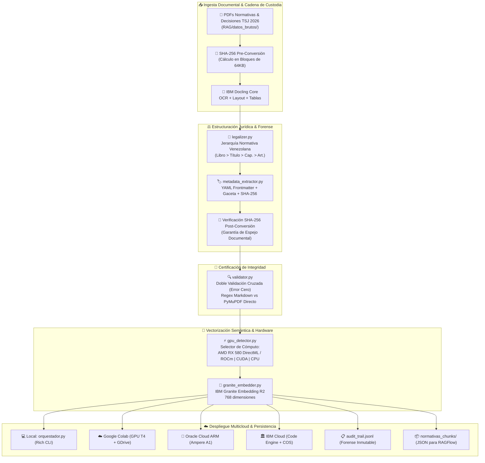

<p align="center">
  
</p>

<h1 align="center">⚖️ JullBrain V3.0</h1>
<h3 align="center">Legal-RAG Engine & Plataforma Forense Multicloud 100% Python</h3>

<p align="center">
  <em>Sistema Enterprise de Inteligencia Documental Legal e Informática Forense para la transformación de normativas y jurisprudencia venezolana en conocimiento estructurado de alta fidelidad, optimizado para IBM Granite, IBM Docling, RAGFlow y Bases de Datos Vectoriales.</em>
</p>

<p align="center">
  <a href="https://colab.research.google.com/github/julljoll/JullBrain/blob/main/JullBrain_Colab.ipynb"></a>
  <a href="https://github.com/julljoll/JullBrain/actions/workflows/colab_sync.yml"></a>
  <a href="https://python.org"></a>
  <a href="LICENSE"></a>
  <a href="https://huggingface.co/ibm-granite"></a>
  <a href="https://github.com/docling-project/docling"></a>
  <a href="#"></a>
  <a href="#"></a>
  <a href="#"></a>
</p>

---

## 📖 Tabla de Contenido

- [¿Qué es JullBrain?](#-qué-es-jullbrain)
- [¿Qué Problema Resuelve?](#-qué-problema-resuelve)
- [Novedades de la Versión 3.0](#-novedades-de-la-versión-30)
- [Características Principales](#-características-principales)
- [Arquitectura del Pipeline y Ecosistema Multicloud](#-arquitectura-del-pipeline-y-ecosistema-multicloud)
- [Stack Tecnológico](#-stack-tecnológico)
- [Aceleración de Cómputo (CPU y Multi-GPU)](#-aceleración-de-cómputo-cpu-y-multi-gpu)
- [Inicio Rápido — Local en Windows / Linux](#-inicio-rápido--local-en-windows--linux)
- [Menú del Orquestador Terminal Interactivo](#-menú-del-orquestador-terminal-interactivo)
- [Despliegue Multicloud](#-despliegue-multicloud)
  - [1. Google Colab (GPU NVIDIA T4)](#1-google-colab-gpu-nvidia-t4)
  - [2. Oracle Cloud Free Tier (ARM Ampere A1)](#2-oracle-cloud-free-tier-arm-ampere-a1)
  - [3. IBM Cloud Serverless (Code Engine + COS)](#3-ibm-cloud-serverless-code-engine--cos)
- [Sincronización Automática GitHub ↔ Multicloud](#-sincronización-automática-github--multicloud)
- [Estructura del Repositorio](#-estructura-del-repositorio)
- [Descripción de Módulos](#-descripción-de-módulos)
- [API REST y Endpoints Headless](#-api-rest-y-endpoints-headless)
- [Control de Calidad Forense (QA) y Auditoría Inmutable](#-control-de-calidad-forense-qa-y-auditoría-inmutable)
- [Configuración Central y Variables de Entorno](#-configuración-central-y-variables-de-entorno)
- [Integraciones Externas](#-integraciones-externas)
- [Archivo Histórico (Legacy)](#-archivo-histórico-legacy)
- [Contribuciones y Principios Éticos](#-contribuciones-y-principios-éticos)
- [Autor y Licencia](#-autor-y-licencia)

---

## 🏛️ ¿Qué es JullBrain?

**JullBrain** es una plataforma de ingeniería documental y de informática forense diseñada para procesar **leyes, códigos, resoluciones y jurisprudencia vinculante del Tribunal Supremo de Justicia (TSJ)** de la República Bolivariana de Venezuela, transformando documentos PDF o HTML complejos en **conocimiento estructurado de alta fidelidad**.

El sistema garantiza que los insumos documentales inyectados a motores RAG, modelos **IBM Granite 3.3 8B** y bases de datos vectoriales respeten estrictamente:
1. **La jerarquía jurídica formal** (*LIBRO > TÍTULO > CAPÍTULO > SECCIÓN > Artículo > Parágrafo*).
2. **La cadena de custodia digital y el principio de "Espejo Documental"** (auditoría criptográfica SHA-256 pre y post procesamiento según normas ISO/IEC 27037 y 27042).
3. **Inferencia jurídica determinística sin alucinación** (temperatura 0.0, corpus cerrado, verificación cruzada y guardrails de seguridad).

---

## ❓ ¿Qué Problema Resuelve?

Los operadores del sistema de justicia (jueces, fiscales, defensores públicos y peritos) enfrentan cientos de normativas extensas y sentencias escaneadas en PDF de difícil lectura digital. Los LLM comerciales generalistas sufren de **alucinación normativa** (inventan artículos o gacetas inexistentes), **desanclaje** y mezcla de jurisdicciones extranjeras.

| Desafío en el Sector Legal | Solución Tecnológica en JullBrain V3.0 |
|:---------------------------|:---------------------------------------|
| **PDFs escaneados, columnas y tablas complejas** | Extracción estructural OCR con **IBM Docling**, reconociendo tablas, layout y metadatos. |
| **Artículos fusionados o desarticulados** | **Legalizer Jerárquico** especializado en técnica legislativa venezolana. |
| **Alucinación de artículos o citas falsas** | Inferencia con **IBM Granite** a **temperatura 0.0**, seed fija y verificación post-generación. |
| **Riesgo de alteración del archivo fuente** | **Principio de Espejo Documental**: comprobación estricta de hash SHA-256 pre y post conversión. |
| **Falta de GPU en equipos locales de trabajo** | Detección de hardware multi-backend (**AMD RX 580 DirectML/ROCm**, CUDA) y despliegue **Multicloud** (Colab, Oracle ARM, IBM Cloud). |
| **Búsqueda semántica imprecisa sobre normas** | Embeddings **IBM Granite Embedding R2** (768 dimensiones) y recuperación híbrida (BM25 + Coseno + RRF). |

---

## 🚀 Novedades de la Versión 3.0

- 🐍 **Migración 100% Python Nativa:** Se eliminó la dependencia de scripts complejos en Batch. Toda la orquestación reside en [`orquestador.py`](orquestador.py) con una interfaz de consola enriquecida con `rich`.
- 🎮 **Aceleración GPU Multiplataforma:** Soporte nativo para **AMD Radeon RX 580 (8GB)** en Windows vía `torch-directml` (DirectX 12) y en Linux vía ROCm 5.7 legacy, además de NVIDIA CUDA y CPU fallback.
- ☁️ **Soporte Multicloud Unificado:**
  - **Google Colab:** Procesamiento acelerado por GPU NVIDIA T4.
  - **Oracle Cloud Free Tier:** Despliegue en servidores ARM Ampere A1 (4 OCPU, 24 GB RAM) con script automatizado [`deploy_oracle.sh`](deploy_oracle.sh).
  - **IBM Cloud:** Contenedor serverless en **Code Engine** y almacenamiento en Cloud Object Storage (COS) con [`deploy_ibmcloud.sh`](deploy_ibmcloud.sh).
- 📜 **Incorporación de Jurisprudencia TSJ 2026:** Soporte para sentencias vinculantes de la Sala Constitucional del TSJ (`RAG/datos_brutos/Desiciones TSJ 2026/` y `RAG/Informacion_docling_rag/Desiciones TSJ 2026/`).
- 🛡️ **Registro Forense Append-Only:** Registro criptográfico inmutable en [`audit_trail.jsonl`](audit_trail.jsonl) que audita cada operación con timestamps UTC y validación de integridad.
- 📦 **Modo Seguro de Conversión:** Procesamiento secuencial (1 documento por vez) para proteger la memoria RAM y evitar congelamientos locales.
- 🗄️ **Archivo Histórico:** Las interfaces web heredadas, GUI Tkinter y esquemas antiguos han sido preservados limpiamente en [`_archivo_historico/`](_archivo_historico/).

---

## ✨ Características Principales

### 🔄 Pipeline de Transformación Legal (6 Fases)

```
PDF / Sentencia TSJ → IBM Docling OCR → Legalizer Jerárquico → Metadata YAML + SHA-256
                   → Validador QA Cruzado (PyMuPDF vs MD) → Embeddings Granite R2 → BBDD Vectorial / RAGFlow
```

### 🖥️ Centro de Control Terminal 100% Python
- Interfaz interactiva basada en `rich` con esquema de colores legal (`#12161A`, amarillo `#FECF06`, verde ciber `#00FF41`).
- Escaneo recursivo en tiempo real de 137+ documentos normativos clasificando estados (*🟢 Ya convertido / 🔴 Pendiente*).
- Menú interactivo con 10 opciones de operación y soporte para banderas CLI directas.

### 🛡️ Seguridad y Cadena de Custodia Digital
- **Air-Gapped Ready:** Operación 100% desconectada de internet en entornos de producción forense.
- **Doble Validación Cruzada:** Principio de Error Cero (conteo de artículos por regex contra el Markdown vs conteo por extracción directa del PDF original vía PyMuPDF).
- **Guardrails de Inferencia:** IBM Granite Guardian para mitigación de inyecciones y verificación de anclaje normativo (*Semáforo 🟢 Anclado / 🟡 Revisión Humana / 🔴 Desanclado*).

---

## 🗺️ Arquitectura del Pipeline y Ecosistema Multicloud



---

## 🛠️ Stack Tecnológico

| Capa | Tecnología | Versión | Propósito |
|:-----|:-----------|:--------|:----------|
| **Lenguaje Base** | Python | 3.11 / 3.12 | Tipado estático, type hints, manejo riguroso de excepciones |
| **CLI / Terminal** | Rich | ≥13.7.0 | Tablas dinámicas, barras de progreso y colores ANSI profesionales |
| **Motor OCR/Layout** | IBM Docling | ≥2.111.0 | Extracción documental avanzada de PDFs escaneados y tablas |
| **Inferencia LLM** | IBM Granite 3.3 8B Instruct | GGUF | Inferencia jurídica determinística (`temp=0.0`, `seed=42`) |
| **Embeddings** | IBM Granite Embedding R2 | 311M Multilingual | Vectores semánticos de 768 dimensiones por artículo normativo |
| **Guardrails** | IBM Granite Guardian | 8B Dense | Detección de alucinación, desanclaje e inyección de prompts |
| **Aceleración AMD Windows** | `torch-directml` | DirectML | Aceleración DirectX 12 para GPU AMD RX 580 (8GB) |
| **Aceleración AMD Linux** | ROCm 5.7 (`gfx803`) | Legacy | Compatibilidad para GPU Polaris 20 en Ubuntu |
| **Aceleración NVIDIA** | PyTorch + CUDA | 12.x | Procesamiento acelerado en Google Colab (GPU T4 / A100) |
| **Backend API Headless** | FastAPI + Uvicorn | ≥0.110.0 | API REST asíncrona para consultas RAG y streaming de eventos |
| **Cloud Object Storage** | `ibm-cos-sdk` / OCI SDK | — | Integración para persistencia de datos en IBM Cloud y Oracle |
| **Forense Criptográfico** | SHA-256 (`hashlib`) | — | Cadena de custodia, verificación de integridad y auditoría |

---

## ⚡ Aceleración de Cómputo (CPU y Multi-GPU)

JullBrain incorpora [`gpu_detector.py`](gpu_detector.py) y [`gpu_config.json`](gpu_config.json) para seleccionar de manera interactiva o automática el mejor dispositivo de cómputo:

```
[1] CPU                     - Universal (seguro, determinístico, sin dependencias extra)
[2] AMD RX 580 DirectML     - Windows via DirectX 12 (torch-directml)
[3] AMD RX 580 ROCm         - Linux via ROCm 5.7 legacy (HSA_OVERRIDE_GFX_VERSION=8.0.3)
[4] NVIDIA CUDA             - CUDA nativo (Google Colab / Servidores con GPU NVIDIA)
```

Al iniciar [`orquestador.py`](orquestador.py), el sistema detecta el hardware disponible y ofrece el menú de aceleración para asegurar que el modelo de embeddings y el motor Docling operen a máxima velocidad sin agotar la memoria del sistema.

---

## 🚀 Inicio Rápido — Local en Windows / Linux

### Requisitos previos
- **Python 3.11 o 3.12** instalado y añadido al PATH del sistema.
- **Git** instalado.
- Mínimo 8 GB de RAM (recomendado 16 GB).

### Instalación en Windows

```cmd
:: 1. Clonar el repositorio
git clone https://github.com/julljoll/JullBrain.git
cd JullBrain

:: 2. Crear el entorno virtual e instalar dependencias
python -m venv docling_env
call docling_env\Scripts\activate
pip install -r requirements.txt

:: 3. Iniciar el Orquestador
orquestador_JullBrain.bat
```

> **Nota sobre `orquestador_JullBrain.bat`:** En la versión 3.0, el archivo `.bat` actúa exclusivamente como un lanzador nativo de 20 líneas que activa el entorno `docling_env` y delega la ejecución completa a `python orquestador.py`.

### Instalación en Linux / macOS

```bash
# 1. Crear y activar entorno virtual
python3 -m venv docling_env
source docling_env/bin/activate

# 2. Instalar dependencias
pip install -r requirements.txt

# 3. Iniciar el orquestador Python
python orquestador.py
```

---

## 🖥️ Menú del Orquestador Terminal Interactivo

Al ejecutar `python orquestador.py`, se despliega la consola interactiva `rich`:

```text
=========================================================================================
  JullBrain V3.0 — CENTRO DE CONTROL LEGAL-RAG (100% PYTHON)
=========================================================================================
  SELECCIONE UNA OPCION DEL CENTRO DE OPERACIONES JULLBRAIN:

    [1] Ver Estado de Archivos Normativos (Tabla RAG de Conversión)
    [2] Convertir UN Archivo Específico (Modo Seguro - 1 por vez)
    [3] Convertir Todos los Archivos Pendientes (Procesamiento Secuencial Seguro)
    [4] Verificación QA de Integridad Cruzada (Validador Cruzado PDF vs MD)
    [5] Generar / Verificar Embeddings Semánticos con Granite R2 (Vectores 768-dim)
    [6] Solo Post-Procesado Legal (Legalizer + Frontmatter YAML)
    [7] Ejecutar Suite Exhaustiva de QA Testing Offline (Air-Gapped)
    [8] Purgar Caché Temporal y Resetear Memoria RAM
    [9] Ver Registro Forense de Auditoría (audit_trail.jsonl)
    [0] Salir
=========================================================================================
```

### Ejecución Directa por Banderas CLI

Para entornos de scripting, CI/CD o automatización:

```bash
python orquestador.py --single-file "RAG/datos_brutos/Penal/copp.pdf"  # Modo seguro un solo archivo
python orquestador.py --full                                          # Procesa todos los pendientes
python orquestador.py --qa                                            # Verificación cruzada PDF vs MD
python orquestador.py --embed                                         # Genera embeddings Granite R2
python orquestador.py --post                                          # Ejecuta post-procesado legal
python orquestador.py --test                                          # Ejecuta suite unitaria de 24 tests
python orquestador.py --clean                                         # Limpia caché y memoria
python orquestador.py --audit                                         # Muestra el log forense
python orquestador.py --web                                           # Inicia servidor FastAPI en puerto 8050
```

---

## ☁️ Despliegue Multicloud

JullBrain V3.0 está optimizado para ejecutarse sin fricción en múltiples nubes:

### 1. Google Colab (GPU NVIDIA T4)
Diseñado para la conversión masiva de normativas pesadas (Constitución, Códigos Orgánicos) aprovechando la GPU NVIDIA gratuita:
- **Notebook:** [`JullBrain_Colab.ipynb`](JullBrain_Colab.ipynb) (15 celdas estructuradas).
- **Dependencias:** [`requirements_colab.txt`](requirements_colab.txt).
- **Persistencia:** Montaje automático opcional en Google Drive.
- **Acceso Directo:** [](https://colab.research.google.com/github/julljoll/JullBrain/blob/main/JullBrain_Colab.ipynb)

### 2. Oracle Cloud Free Tier (ARM Ampere A1)
Aprovecha las 4 OCPU y 24 GB de memoria RAM de la capa gratuita de Oracle Cloud en arquitectura `aarch64` (Ubuntu 22.04):
- **Script de Despliegue:** [`deploy_oracle.sh`](deploy_oracle.sh) (instala librerías del sistema, crea servicio `systemd` y configura `uvicorn`).
- **Dependencias:** [`requirements_oracle.txt`](requirements_oracle.txt).
- **Configuración:** [`oracle_config.json`](oracle_config.json).
- **Instalación rápida en la instancia Oracle:**
  ```bash
  git clone https://github.com/julljoll/JullBrain.git
  cd JullBrain
  chmod +x deploy_oracle.sh
  ./deploy_oracle.sh
  ```

### 3. IBM Cloud Serverless (Code Engine + COS)
Despliegue contenerizado serverless en **IBM Cloud Code Engine** con almacenamiento en **IBM Cloud Object Storage (COS)**:
- **Dockerfile:** [`Dockerfile`](Dockerfile) optimizado multi-etapa sobre `python:3.11-slim`.
- **Script de Despliegue:** [`deploy_ibmcloud.sh`](deploy_ibmcloud.sh) (compila la imagen y la publica en IBM Cloud Container Registry).
- **Dependencias:** [`requirements_ibmcloud.txt`](requirements_ibmcloud.txt) (incluye `ibm-cos-sdk`).
- **Configuración:** [`ibmcloud_config.json`](ibmcloud_config.json).

---

## 🔄 Sincronización Automática GitHub ↔ Multicloud

```
┌──────────────────────────────────────────────────────────────────┐
│                                                                  │
│  💻 PC Local (Windows/Linux)      ☁️ Google Colab / Oracle / IBM │
│  ────────────────────────────     ─────────────────────────────  │
│  Trabajas o editas normativas     Al inicializar ejecutan:       │
│               ↓                   !git pull origin main          │
│  git push origin <rama>           → Obtienen el código y los     │
│               ↓                     manifiestos actualizados     │
│  GitHub Actions CI (colab_sync)   → Procesan con GPU / ARM       │
│               ↓                   → Almacenan en Cloud Storage   │
│  ✅ Validación y Merge                                           │
│                                                                  │
└──────────────────────────────────────────────────────────────────┘
```

El flujo de trabajo [`.github/workflows/colab_sync.yml`](.github/workflows/colab_sync.yml) valida sintaxis de los scripts Python, integridad del cuaderno Colab y coherencia de las configuraciones JSON en cada push.

---

## 📁 Estructura del Repositorio

```
JullBrain/
│
├── 🚀 ORQUESTACIÓN & ENTRYPOINTS
│   ├── orquestador.py                 # Orquestador terminal 100% Python con rich (622 líneas)
│   ├── orquestador_JullBrain.bat      # Lanzador nativo Windows ultra-ligero (≤20 líneas)
│   ├── app.py                         # Backend FastAPI headless para consultas RAG y endpoints
│   ├── JullBrain_Colab.ipynb          # Cuaderno Google Colab con aceleración GPU NVIDIA
│   ├── gpu_detector.py                # Detector y selector de hardware (CPU / AMD DirectML / ROCm / CUDA)
│   └── gpu_config.json                # Configuración de dispositivos de aceleración
│
├── ⚖️ PIPELINE DE TRANSFORMACIÓN LEGAL FORENSE
│   ├── convert_normativas.py          # Ingesta IBM Docling + Hierarchical Chunking (830 líneas)
│   ├── legalizer.py                   # Jerarquía formal venezolana: Libro/Título/Cap./Art. (387 líneas)
│   ├── metadata_extractor.py          # Extracción YAML Frontmatter + Gaceta Oficial + SHA-256
│   └── validator.py                   # Doble validación cruzada PDF vs MD (Principio Error Cero)
│
├── 🧠 MOTOR DE EMBEDDINGS Y BÚSQUEDA
│   ├── granite_embedder.py            # IBM Granite Embedding R2 (768 dimensiones, sentence-transformers)
│   ├── opensearch_indexer.py          # Motor Híbrido: BM25 + Coseno + RRF + Cross-Encoder Reranker
│   └── lightrag_integration.py        # GraphRAG: extracción de entidades y relaciones jurídicas
│
├── 🛡️ SEGURIDAD, AUDITORÍA Y FORENSE
│   ├── granite_guardian_guardrail.py   # Guardrails anti-alucinación IBM Granite Guardian
│   ├── audit_logger.py                # Logger de eventos forenses criptográficos
│   ├── audit_trail.jsonl              # Registro inmutable append-only con hashes SHA-256
│   └── notebook_manager.py            # Gestor de expedientes aislados con hash criptográfico
│
├── ☁️ MULTICLOUD & DESPLIEGUE
│   ├── deploy_oracle.sh               # Script de aprovisionamiento para Oracle Cloud ARM
│   ├── oracle_config.json             # Configuración de servidor y Object Storage en OCI
│   ├── requirements_oracle.txt        # Dependencias optimizadas para ARM aarch64
│   ├── deploy_ibmcloud.sh             # Script de despliegue para IBM Cloud Code Engine
│   ├── ibmcloud_config.json           # Configuración serverless y Cloud Object Storage (COS)
│   ├── requirements_ibmcloud.txt      # Dependencias para contenedor IBM Cloud (ibm-cos-sdk)
│   ├── Dockerfile                     # Imagen contenedor optimizada para Code Engine
│   ├── colab_runner.py                # Motor de ejecución unificado para Google Colab
│   ├── colab_config.json              # Configuración de carpetas y GPU en Colab
│   ├── requirements_colab.txt         # Dependencias optimizadas para Colab CUDA
│   └── sincronizar_resultados.py      # Utilidad de sincronización local ↔ GitHub ↔ Cloud
│
├── 📄 DATOS JURÍDICOS (CORPUS RAG)
│   ├── RAG/datos_brutos/              # PDFs originales clasificados por materia (137+ documentos)
│   │   ├── Penal/                     # COPP, Ley contra Delitos Informáticos, etc.
│   │   ├── Civil/                     # Código Civil, Código de Procedimiento Civil, etc.
│   │   ├── Constitucion/              # CRBV 1999 con enmiendas
│   │   └── Desiciones TSJ 2026/       # Sentencias vinculantes de la Sala Constitucional
│   ├── RAG/Informacion_docling_rag/   # Markdown estructurado post-procesado con YAML
│   └── normativas_chunks/             # Chunks atómicos JSON por artículo para RAGFlow
│
├── 🧪 PRUEBAS Y CONTROL DE CALIDAD
│   └── tests/
│       ├── test_qa_offline.py         # 14 pruebas de integridad, jerarquía, hashes y guardrails
│       ├── test_unit.py               # Pruebas unitarias de endpoints y almacenamiento
│       └── test_integration.py        # Pruebas de integración del pipeline completo
│
├── 🗄️ ARCHIVO HISTÓRICO (LEGACY)
│   └── _archivo_historico/            # Archivos preservados para referencia histórica
│       ├── web_legacy/                # Interfaz web HTML5/CSS3 original
│       ├── gui_legacy.py              # Interfaz gráfica de escritorio Tkinter original
│       ├── JullBrain_legacy.spec      # Especificación PyInstaller legacy
│       └── db_schema_legacy.sql       # Esquema SQL relacional antiguo
│
├── .env.example                       # Plantilla de variables de entorno (OCI, IBM, Salts)
├── pipeline_config.json               # Configuración central del pipeline RAG
├── requirements.txt                   # Dependencias para entorno local
└── LICENSE                            # Licencia Apache 2.0
```

---

## 📦 Descripción de Módulos

### `orquestador.py` — Centro de Mando 100% Python
Sustituye la complejidad de scripts de consola por una aplicación modular en Python. Se encarga de:
- Escanear el corpus en tiempo real y mostrar tablas de estado con `rich`.
- Gestionar la inicialización del hardware (CPU, AMD DirectML, ROCm, CUDA).
- Convertir en modo seguro (1 archivo a la vez) preservando la inmutabilidad documental mediante verificación SHA-256 pre y post conversión.
- Asentar entradas de auditoría forense inmutable en `audit_trail.jsonl`.

### `convert_normativas.py` — Motor de Ingesta con IBM Docling
Realiza la conversión de PDFs legales a Markdown estructurado:
- Soporta PDFs escaneados aplicando OCR inteligente.
- Maneja documentos con columnas múltiples y tablas complejas.
- Divide artículos en chunks atómicos jerárquicos en formato JSON listos para RAGFlow.

### `legalizer.py` — Estructuración de Jerarquía Normativa
Aplica la técnica legislativa venezolana sobre el Markdown generado:
- Normaliza marcadores (`Artículo 1°`, `Art. 1`, `ARTICULO`).
- Expande rangos derogados (`Artículos 4 al 8` → 5 artículos individuales catalogados como derogados).
- Reconstruye palabras rotas por saltos de línea de OCR y elimina encabezados/pies repetitivos.

### `validator.py` — Validador Forense de Error Cero
Compara mediante dos algoritmos independientes:
1. Conteo de artículos por expresiones regulares sobre el Markdown generado.
2. Extracción directa del PDF original utilizando **PyMuPDF (`fitz`)**.
Si los números difieren, emite una alerta forense para auditoría humana antes de permitir la indexación.

### `granite_embedder.py` — Motor de Embeddings Semánticos
Vectoriza los chunks normativos generando embeddings de 768 dimensiones con `ibm-granite/granite-embedding-311m-multilingual-r2`. Soporta ejecución local vía `sentence-transformers` o mediante API de Ollama.

### `granite_guardian_guardrail.py` — Guardrails Anti-Alucinación
Audita consultas y respuestas jurídicas:
- Verifica anclaje normativo estricto (*groundedness*).
- Bloquea intentos de manipulación o inyección de prompt.
- Retorna el semáforo de confianza jurídica: 🟢 Anclado, 🟡 Revisión Humana, 🔴 Desanclado.

---

## 🌐 API REST y Endpoints Headless

FastAPI proporciona una capa de servicio headless en `http://localhost:8050`:

| Método | Endpoint | Descripción |
|:-------|:---------|:------------|
| `GET` | `/health` | Chequeo de salud del backend, modelos de embeddings y guardrails |
| `POST` | `/api/v1/query` | Consulta RAG jurídica: recibe pregunta, retorna respuesta fundamentada con citas |
| `POST` | `/api/v1/upload` | Carga de nuevo documento con cálculo previo de hash SHA-256 |
| `POST` | `/api/v1/pipeline/action` | Disparo asíncrono de acciones del pipeline (conversión, post-proceso, embeddings) |
| `GET` | `/api/v1/pipeline/logs` | Streaming Server-Sent Events (SSE) de logs en tiempo real |
| `POST` | `/api/v1/notebooks` | Creación de cuadernos/expedientes jurídicos aislados con firma digital |
| `GET` | `/api/v1/notebooks` | Listado de expedientes con metadatos de custodia |

---

## 🧪 Control de Calidad Forense (QA) y Auditoría Inmutable

### Ejecución de Pruebas Unitarias e Integración
```bash
python -m unittest discover tests -v
```

La suite certifica **24 pruebas** que validan:
- **Jerarquía y Chunking:** Verificación de artículos del COPP y Constitución sin solapamiento.
- **Inmutabilidad Criptográfica:** Consistencia de hashes SHA-256 pre y post extracción.
- **Búsqueda Híbrida:** Funcionamiento de BM25 + Similitud Coseno + Fusión RRF.
- **Abstención Obligatoria:** Capacidad del sistema de responder "Normativa no localizada" ante preguntas fuera de corpus sin inventar citas.
- **Air-Gapped:** Verificación de ausencia de peticiones de red salientes durante la inferencia.

### Inspección del Registro de Auditoría
El archivo [`audit_trail.jsonl`](audit_trail.jsonl) registra en formato JSON Lines cada conversión con:
```json
{
  "timestamp": "2026-10-23T11:34:09.123456+00:00",
  "entorno": "local",
  "backend_gpu": "directml",
  "archivo": "copp.pdf",
  "sha256_pdf_antes": "4f693857fe677f4141acce1c14c3ec4c4bf2a73ce869989e5de8931666398abd",
  "sha256_pdf_despues": "4f693857fe677f4141acce1c14c3ec4c4bf2a73ce869989e5de8931666398abd",
  "integridad_pdf": "OK",
  "exito_conversion": true,
  "duracion_seg": 18.42
}
```

---

## ⚙️ Configuración Central y Variables de Entorno

### Variables de Entorno (`.env.example`)
Copie `.env.example` a `.env` para personalizar entornos:
```bash
# Entorno activo: local | colab | oracle | ibmcloud
JULLBRAIN_ENV=local

# Sales criptográficas para auditoría forense
JULLBRAIN_AUDIT_SALT=EnterpriseLegalRAG_2026_Salt
JULLBRAIN_NOTEBOOK_SALT=JullBrain_Legal_Salt_2026

# Oracle Cloud Object Storage (opcional)
ORACLE_OBJECT_STORAGE_BUCKET=jullbrain-rag
ORACLE_REGION=sa-vinhedo-1

# IBM Cloud COS (opcional)
# IBM_COS_API_KEY=tu_api_key
```

### Configuración del Pipeline (`pipeline_config.json`)
```jsonc
{
  "granite_model": "ibm-granite/granite-3.3-8b-instruct-GGUF",
  "granite_temperature": 0.0,
  "granite_fixed_seed": 42,
  "ragflow_embedding_model": "ibm-granite/granite-embedding-311m-multilingual-r2",
  "embedding_backend": "sentence-transformers",
  "embedding_device": "cpu",
  "entorno_activo": "auto"
}
```

---

## 🔌 Integraciones Externas

| Ecosistema | Modo de Integración | Estado |
|:-----------|:--------------------|:-------|
| **RAGFlow** | Exportación de chunks JSON jerárquicos | ✅ Nativo |
| **Open WebUI** | Pipeline API compatible (`openwebui_pipeline.py`) | ✅ Operativo |
| **Ollama** | Endpoint local para Granite 3.3 y embeddings | ✅ Operativo |
| **OpenSearch** | Motor de búsqueda híbrida distribuida | ⚙️ Configurable |
| **IBM watsonx.ai** | Inferencia enterprise en la nube | ⚙️ Opcional |

---

## 🗄️ Archivo Histórico (Legacy)

En [`_archivo_historico/`](_archivo_historico/) se preservan los componentes de versiones previas con fines de trazabilidad y compatibilidad:
- `web_legacy/`: Interfaz web monolítica HTML5/CSS3 previa.
- `gui_legacy.py`: Interfaz de escritorio desarrollada en Tkinter.
- `JullBrain_legacy.spec`: Archivo PyInstaller para binarios monolíticos Windows.
- `db_schema_legacy.sql`: Esquema SQL relacional antiguo para PostgreSQL.

---

## 🤝 Contribuciones y Principios Éticos

Las contribuciones se rigen por las directrices del proyecto:
1. **El sistema acelera, nunca decide ni sustituye el criterio del operador judicial** (Resolución CNJ n.° 332/2020).
2. **Corpus cerrado y versionado:** Ninguna normativa se agrega sin registro de Gaceta Oficial y hash SHA-256.
3. **Chunking atómico:** Los artículos no deben mezclarse ni fragmentarse arbitrariamente.
4. **Cero tolerancia a la alucinación:** Temperatura 0.0 y abstención obligatoria ante falta de respaldo normativo.

---

## 👤 Autor y Licencia

**Jull Ortiz** — *Arquitecto de Datos con y para la Inteligencia Artificial Jurídica*
- 🌐 Portal: [sha256.us](http://www.sha256.us/)
- 🏛️ Repositorio Oficial: [github.com/julljoll/JullBrain](https://github.com/julljoll/JullBrain)

Distribuido bajo la **Licencia Apache 2.0**. Consulte [LICENSE](LICENSE) para más detalles.  
*Los modelos IBM Granite son propiedad de IBM Research bajo licencia Apache 2.0. IBM Docling es distribuido bajo licencia MIT.*
