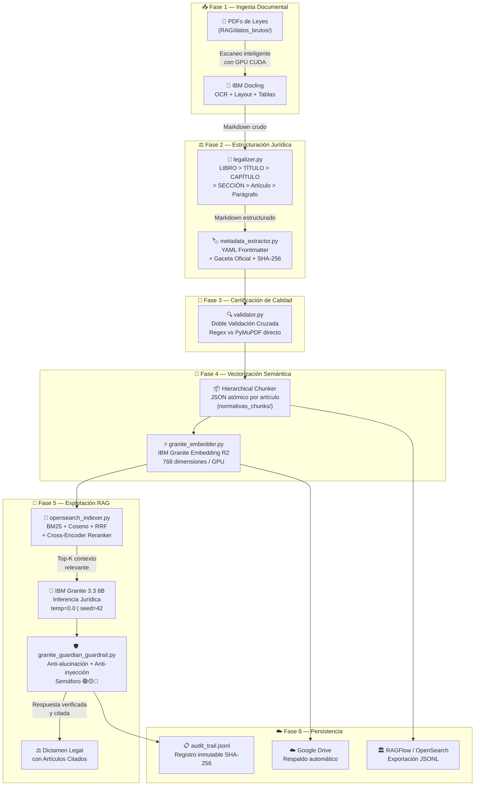

<p align="center">
  
</p>

<h1 align="center">⚖️ JullBrain V3.0</h1>
<h3 align="center">Legal-RAG Engine & Plataforma de Informática Forense Digital</h3>

<p align="center">
  <em>Sistema Enterprise de Inteligencia Documental Legal para la transformación precisa de normativas venezolanas en conocimiento estructurado, optimizado para Bases de Datos Vectoriales, IBM Granite y Sistemas RAG.</em>
</p>

<p align="center">
  <a href="https://colab.research.google.com/github/julljoll/JullBrain/blob/main/JullBrain_Colab.ipynb"></a>
  <a href="https://github.com/julljoll/JullBrain/actions/workflows/colab_sync.yml"></a>
  <a href="https://python.org"></a>
  <a href="LICENSE"></a>
  <a href="https://huggingface.co/ibm-granite"></a>
  <a href="https://github.com/docling-project/docling"></a>
  <a href="#"></a>
</p>

---

## 📖 Tabla de Contenido

- [¿Qué es JullBrain?](#-qué-es-jullbrain)
- [¿Qué Problema Resuelve?](#-qué-problema-resuelve)
- [Características Principales](#-características-principales)
- [Arquitectura del Pipeline](#-arquitectura-del-pipeline)
- [Stack Tecnológico](#-stack-tecnológico)
- [Inicio Rápido — Local en Windows](#-inicio-rápido--local-en-windows)
- [Inicio Rápido — Google Colab con GPU](#-inicio-rápido--google-colab-con-gpu)
- [Sincronización Automática GitHub ↔ Colab](#-sincronización-automática-github--colab)
- [Estructura del Repositorio](#-estructura-del-repositorio)
- [Descripción de Módulos](#-descripción-de-módulos)
- [API REST y Endpoints](#-api-rest-y-endpoints)
- [Control de Calidad Forense (QA)](#-control-de-calidad-forense-qa)
- [Configuración Avanzada](#-configuración-avanzada)
- [Integraciones Externas](#-integraciones-externas)
- [Contribuciones](#-contribuciones)
- [Licencia](#-licencia)

---

## 🏛️ ¿Qué es JullBrain?

**JullBrain** es un pipeline de procesamiento documental diseñado específicamente para transformar **leyes, códigos, resoluciones y normativas venezolanas** en formato PDF a **datos estructurados de alta precisión** listos para alimentar:

- **Bases de datos vectoriales** (RAGFlow, OpenSearch, pgvector)
- **Sistemas de Generación Aumentada por Recuperación** (RAG)
- **Modelos de Lenguaje de IBM Granite** (inferencia jurídica con cero alucinaciones)

El sistema opera en **modo dual**: como aplicación **100% local offline** (air-gapped) mediante un orquestador `.bat` en Windows, y como **pipeline acelerado por GPU NVIDIA** en Google Colab, con sincronización automática entre ambos entornos vía GitHub.

---

## ❓ ¿Qué Problema Resuelve?

Los profesionales del Derecho en Venezuela (jueces, fiscales, defensores, peritos forenses) trabajan con cientos de instrumentos jurídicos en formato PDF que no pueden ser consultados de forma inteligente. Las herramientas de IA generalistas como ChatGPT **alucinan artículos inexistentes**, **citan leyes derogadas** y **mezclan jurisdicciones**.

**JullBrain resuelve esto** mediante:

| Problema | Solución JullBrain |
|:---------|:-------------------|
| PDFs de leyes escaneados e ilegibles | OCR inteligente con **IBM Docling** que reconoce layout, tablas y columnas |
| Artículos fusionados o mal separados | **Legalizer** con regex jurídico: separa LIBRO > TÍTULO > CAPÍTULO > Artículo |
| IA que inventa artículos | **Temperatura 0.0**, corpus cerrado y verificación post-generación de citas |
| Sin control de integridad documental | **SHA-256** por documento y doble validación cruzada PDF vs Markdown |
| Procesamiento lento en máquinas locales | **Google Colab con GPU T4** gratuita para procesar volúmenes masivos |
| Sin búsqueda semántica sobre leyes | **Embeddings IBM Granite R2** de 768 dimensiones por cada artículo |

---

## ✨ Características Principales

### 🔄 Pipeline de Transformación Legal (6 Fases)

```
PDF Ley → IBM Docling OCR → Legalizer Jerárquico → Metadata YAML+SHA256
       → Validador QA Cruzado → Embeddings Granite R2 → BBDD Vectorial
```

### 🖥️ Centro de Control Web (`http://localhost:8050`)
- Interfaz unificada HTML5/CSS3 con modo oscuro cyber-legal
- Subida de documentos con arrastrar y soltar (Drag & Drop)
- Cálculo SHA-256 en el navegador antes de la subida
- Consola de streaming de logs del pipeline en tiempo real
- Asistente RAG interactivo para consultas jurídicas

### 🛡️ Seguridad y Forense Digital
- Operación **100% Air-Gapped** (sin peticiones salientes a internet en producción)
- **Auditoría inmutable** con firmas SHA-256 por cada evento (`audit_trail.jsonl`)
- Gestión de expedientes aislados con integridad criptográfica verificable
- Guardrails anti-inyección con **IBM Granite Guardian**
- Semáforo de confianza (🟢 Anclado / 🟡 Revisión Humana / 🔴 Desanclado)

### ☁️ Operación Dual: Local + Nube
- **Windows Local:** Doble clic en `orquestador_JullBrain.bat` → menú interactivo con 9 opciones
- **Google Colab:** Notebook de 15 secciones con auto-pull de GitHub, montaje de Drive y GPU NVIDIA
- **Sincronización CI/CD:** GitHub Actions valida cada push y el Colab obtiene la última versión automáticamente

---

## 🗺️ Arquitectura del Pipeline



---

## 🛠️ Stack Tecnológico

| Capa | Tecnología | Versión | Propósito |
|:-----|:-----------|:--------|:----------|
| **Motor OCR** | IBM Docling | ≥2.111.0 | Extracción inteligente de PDF: layout, tablas, columnas, OCR |
| **Motor de IA** | IBM Granite 3.3 8B Instruct | GGUF | Inferencia jurídica con temperatura cero y corpus cerrado |
| **Embeddings** | IBM Granite Embedding R2 | 311M Multilingual | Vectores densos de 768 dimensiones por artículo normativo |
| **Guardrails** | IBM Granite Guardian | 8B Dense | Detección de alucinaciones, inyecciones y desanclaje |
| **Backend API** | FastAPI + Uvicorn | ≥0.110 | API REST de alto rendimiento con streaming de logs |
| **Interfaz Web** | HTML5 + CSS3 + Vanilla JS | — | Centro de control Dark Mode con Drag & Drop y RAG chat |
| **Búsqueda Híbrida** | BM25 + Coseno NumPy + RRF | — | Fusión de búsqueda léxica y semántica con reranking |
| **Grafo RAG** | LightRAG (HKU) | ≥1.0 | Extracción de entidades y relaciones jurídicas |
| **Validación PDF** | PyMuPDF (fitz) + pypdf | ≥1.28 | Extracción directa para doble validación cruzada |
| **Lenguaje** | Python | 3.12 | Tipado estricto, type hints, manejo exhaustivo de errores |
| **Orquestador** | Batch Script (.bat) | CMD | Menú interactivo nativo Windows con colores ANSI |
| **CI/CD** | GitHub Actions | v4 | Validación automática de sintaxis, notebook y configuración |
| **Aceleración GPU** | Google Colab | T4 / A100 | Procesamiento masivo con CUDA gratuito |
| **Criptografía** | SHA-256 (hashlib) | — | Cadena de custodia e integridad forense documental |

---

## 🚀 Inicio Rápido — Local en Windows

### Requisitos previos
- **Python 3.12+** instalado y accesible desde PATH
- **Git** instalado (para sincronización con GitHub)
- ~4 GB de espacio libre (modelos de Docling + embeddings)

### Instalación y ejecución

```cmd
:: 1. Clonar el repositorio
git clone https://github.com/julljoll/JullBrain.git
cd JullBrain

:: 2. Ejecutar el orquestador (crea el entorno virtual automáticamente)
orquestador_JullBrain.bat
```

El orquestador:
1. Crea el entorno virtual `docling_env` si no existe
2. Activa el entorno e instala dependencias
3. Despliega el menú interactivo:

```
  SELECCIONE UNA OPCION DEL CENTRO DE OPERACIONES:

    [1] Iniciar Centro de Control Web (HTML5/CSS3) - http://localhost:8050
    [2] Conversión Completa con IBM Docling (Ingesta + Legalizer + Metadata + QA)
    [3] Verificación QA Cruzada (Validador Cruzado PDF vs MD)
    [4] Solo Post-Procesado Legal (Legalizer + Frontmatter YAML)
    [5] Generar / Verificar Embeddings Semánticos con Granite R2 (768-dim)
    [6] Ejecutar Suite de QA Testing Offline (Air-Gapped)
    [7] Purgar Caché Temporal y Resetear Memoria
    [8] Sincronizar con GitHub (git pull origin main)
    [9] Abrir Google Colab en Navegador (GPU Acelerada)
    [0] Salir
```

### Ejecución directa por línea de comandos

```cmd
:: Iniciar servidor web sin menú interactivo
orquestador_JullBrain.bat --web

:: Conversión completa directa
orquestador_JullBrain.bat --full

:: Sincronizar con GitHub
orquestador_JullBrain.bat --sync
```

### Uso manual (Linux / Mac / Terminal avanzado)

```bash
# 1. Crear y activar entorno virtual
python -m venv docling_env
source docling_env/bin/activate          # Windows: docling_env\Scripts\activate

# 2. Instalar dependencias
pip install -r requirements.txt

# 3. Procesar leyes
python convert_normativas.py             # Conversión completa
python convert_normativas.py --post-process-only  # Solo post-procesado legal

# 4. Validar integridad
python validator.py

# 5. Generar embeddings
python granite_embedder.py

# 6. Iniciar servidor web
python -m uvicorn app:app --host 127.0.0.1 --port 8050
```

---

## ☁️ Inicio Rápido — Google Colab con GPU

Para procesar leyes pesadas (Constitución, COPP, códigos orgánicos) sin consumir recursos de tu máquina local:

### Paso 1 — Abrir el Cuaderno
Haz clic en el botón:

[](https://colab.research.google.com/github/julljoll/JullBrain/blob/main/JullBrain_Colab.ipynb)

### Paso 2 — Activar la GPU
En Google Colab: `Entorno de ejecución` → `Cambiar tipo de entorno de ejecución` → **GPU T4**

### Paso 3 — Ejecutar Todo
Presiona `Ctrl + F9` (*Ejecutar todo*). El cuaderno realizará automáticamente:

1. ⚙️ Diagnóstico de GPU (VRAM, CUDA, modelo detectado)
2. 🔄 Clonación / actualización del repositorio desde GitHub
3. 📦 Instalación de `requirements_colab.txt` optimizado para Colab
4. ☁️ Montaje de Google Drive (opcional, para persistir PDFs y resultados)
5. 🔍 Inspección del corpus jurídico disponible
6. 🏛️ Conversión completa con IBM Docling en GPU
7. ⚖️ Control de jerarquía legal con Legalizer
8. 🔬 Doble validación cruzada forense
9. 🧠 Vectorización con IBM Granite Embedding R2 en CUDA
10. 🔐 Generación de manifiesto criptográfico SHA-256
11. ☁️ Respaldo automático de resultados en Google Drive
12. 📤 Exportación en formato `.jsonl` para RAGFlow

### Dónde colocar los PDFs de leyes

Opción A — **Google Drive** (recomendado para Colab):
```
Mi unidad/JullBrain/leyes_pdf/
├── Penal/
│   ├── copp.pdf
│   └── ley-contra-delitos-informaticos.pdf
├── Civil/
│   └── codigo-civil.pdf
└── Constitucion/
    └── constitucion-rbv-1999.pdf
```

Opción B — **Carpeta local** (para modo offline):
```
JullBrain/RAG/datos_brutos/
├── Penal/
├── Civil/
├── Constitucion/
└── ...
```

---

## 🔄 Sincronización Automática GitHub ↔ Colab

```
┌──────────────────────────────────────────────────────────────────┐
│                                                                  │
│  🖥️ PC Local                      ☁️ Google Colab                │
│  ──────────                      ─────────────                   │
│  Editas código                   El Colab ejecuta al inicio:     │
│       ↓                          !git pull origin main            │
│  git push origin main            → Siempre tiene la última       │
│       ↓                            versión del código             │
│  GitHub Actions CI               → Procesa leyes con GPU         │
│  (Validación automática)         → Guarda en Google Drive        │
│       ↓                                                          │
│  ✅ Badge "passing"                                              │
│                                                                  │
└──────────────────────────────────────────────────────────────────┘
```

**GitHub Actions** ejecuta en cada push a `main`:
- Compilación de todos los módulos Python (13 archivos `.py`)
- Validación del notebook Colab (≥15 celdas, estructura correcta)
- Verificación de `pipeline_config.json` y `colab_config.json`
- Linting semanal y ejecución de suite de tests QA

---

## 📁 Estructura del Repositorio

```
JullBrain/
│
├── 🚀 ENTRYPOINTS
│   ├── orquestador_JullBrain.bat      # Lanzador nativo Windows (menú interactivo 9 opciones)
│   ├── app.py                         # Backend FastAPI + Servidor Web (http://localhost:8050)
│   └── JullBrain_Colab.ipynb          # Cuaderno Google Colab (15 secciones, GPU optimizado)
│
├── ⚖️ PIPELINE DE TRANSFORMACIÓN LEGAL
│   ├── convert_normativas.py          # Ingesta con IBM Docling + Hierarchical Chunking (813 líneas)
│   ├── legalizer.py                   # Jerarquía legal venezolana: Libro/Título/Cap./Art. (387 líneas)
│   ├── metadata_extractor.py          # Extracción YAML Frontmatter + Gaceta Oficial + SHA-256
│   └── validator.py                   # Doble validación cruzada PDF vs MD (Principio Error Cero)
│
├── 🧠 MOTOR DE EMBEDDINGS Y BÚSQUEDA
│   ├── granite_embedder.py            # IBM Granite Embedding R2 (768-dim, sentence-transformers)
│   ├── opensearch_indexer.py          # Motor Híbrido: BM25 + Coseno + RRF + Cross-Encoder Reranker
│   └── lightrag_integration.py        # GraphRAG: entidades y relaciones jurídicas con LightRAG
│
├── 🛡️ SEGURIDAD Y AUDITORÍA
│   ├── granite_guardian_guardrail.py   # Guardrails anti-alucinación con IBM Granite Guardian
│   ├── audit_logger.py                # Registro inmutable JSONL con firmas SHA-256
│   └── notebook_manager.py            # Gestor de expedientes aislados con hash criptográfico
│
├── 🌐 INTERFAZ WEB
│   └── web/
│       ├── index.html                 # Centro de control: dashboard, subida, chat RAG
│       ├── styles.css                 # Diseño Dark Mode cyber-legal (15K líneas CSS)
│       └── app.js                     # Cliente JS: SHA-256 en browser, streaming de logs
│
├── ☁️ GOOGLE COLAB & CI/CD
│   ├── colab_runner.py                # Motor de ejecución unificado para Colab
│   ├── colab_config.json              # Configuración: Google Drive, GPU, batch sizes
│   ├── requirements_colab.txt         # Dependencias optimizadas para Colab CUDA
│   ├── sincronizar_resultados.py      # Herramienta de sync local ↔ GitHub ↔ Colab
│   └── .github/workflows/
│       ├── colab_sync.yml             # CI: validación de pipeline + notebook en cada push
│       └── ci_quality.yml             # QA semanal: linting + tests de integridad
│
├── 🔌 INTEGRACIONES
│   ├── openwebui_pipeline.py          # Pipeline compatible con Open WebUI API
│   ├── db_schema.sql                  # Esquema PostgreSQL para producción enterprise
│   └── pipeline_config.json           # Configuración central persistente (Granite, RAG, GPU)
│
├── 🧪 TESTING
│   └── tests/
│       ├── test_qa_offline.py         # 14 pruebas: jerarquía, hashes, búsqueda, guardrail
│       ├── test_unit.py               # Pruebas unitarias de endpoints y almacenamiento
│       └── test_integration.py        # Pruebas de integración del pipeline RAG completo
│
├── 📚 DOCUMENTACIÓN
│   └── docs/
│       ├── ARCHITECTURE.md            # Arquitectura técnica del sistema
│       ├── FLUJO_COLAB.md             # Guía paso a paso para Google Colab
│       ├── USER_MANUAL.md             # Manual de usuario final
│       ├── TECHNICAL_MANUAL.md        # Manual técnico de módulos
│       └── *.svg                      # Diagramas UML y de flujo del pipeline
│
├── 📄 DATOS
│   ├── RAG/datos_brutos/              # PDFs de leyes organizados por materia (137+ leyes)
│   ├── normativas_rag/                # Markdown estructurado post-procesado
│   └── normativas_chunks/             # JSON atómico por artículo (chunks jerárquicos)
│
├── requirements.txt                   # Dependencias Python para entorno local
├── requirements.lock.txt              # Versiones exactas bloqueadas
└── LICENSE                            # Apache License 2.0
```

---

## 📦 Descripción de Módulos

### `convert_normativas.py` — Motor de Ingesta Principal
Orquesta la conversión de documentos PDF a Markdown estructurado usando IBM Docling. Soporta procesamiento por lotes con caché SHA-256 inteligente (no re-procesa PDFs sin cambios). Incluye soporte para:
- PDFs escaneados (OCR automático)
- Documentos con tablas complejas
- Archivos `.doc` heredados (conversión automática vía Word COM)
- Procesamiento en subprocesos para archivos pesados (>100 páginas)

### `legalizer.py` — Post-Procesador Jerárquico Legal
Toma el Markdown crudo de Docling y aplica la jerarquía formal del derecho venezolano:
```
LIBRO > TÍTULO > CAPÍTULO > SECCIÓN > Artículo > Parágrafo
```
- Normaliza variantes de marcadores: `Art.`, `Artículo`, `ARTICULO`, `Art. N°`
- Expande rangos derogados: `Artículos 6 al 10` → 5 artículos individuales marcados como derogados
- Elimina ruido de OCR (cuadros ilegibles, números de página)
- Repara palabras partidas por salto de línea (`constitu-\nción` → `constitución`)
- Detecta automáticamente el tipo de instrumento legal (Constitución, Código, Ley Orgánica, etc.)

### `metadata_extractor.py` — Extractor de Metadatos Semánticos
Genera un bloque YAML frontmatter al inicio de cada Markdown con:
- Título oficial del instrumento
- Número de Gaceta Oficial
- Fecha de publicación (detección automática de fechas en español)
- Tipo de instrumento jurídico
- Hash SHA-256 del PDF original
- Conteo de artículos detectados

### `validator.py` — Validador de Integridad con Doble Verificación Cruzada
Implementa el **Principio de Error Cero** mediante dos métodos independientes:
1. **Método A:** Conteo de artículos por regex sobre el Markdown generado
2. **Método B:** Extracción directa del PDF original con PyMuPDF

Si ambos conteos coinciden → ✅ Artículo verificado. Si difieren → ⚠️ Anomalía reportada para revisión humana.

### `granite_embedder.py` — Motor de Embeddings Semánticos
Genera vectores densos de 768 dimensiones usando `ibm-granite/granite-embedding-311m-multilingual-r2`:
- Backend primario: `sentence-transformers` (local, sin internet)
- Backend fallback: API de Ollama (HTTP local)
- Soporte GPU CUDA con media precisión (FP16) en Colab
- Modo batch configurable (32 en CPU, 64 en GPU)

### `opensearch_indexer.py` — Motor de Búsqueda Híbrida
Implementa un pipeline de recuperación de 4 etapas:
1. **BM25** — Búsqueda léxica tokenizada en español
2. **Similitud Coseno** — Búsqueda vectorial con NumPy
3. **Fusión RRF** — Reciprocal Rank Fusion de ambos resultados
4. **Cross-Encoder Reranker** — Re-ordenamiento final por relevancia semántica

Funciona 100% offline en memoria/disco, sin requerir un clúster OpenSearch externo.

### `granite_guardian_guardrail.py` — Guardrails de Seguridad
Audita cada consulta y respuesta del sistema:
- **Prompt Safety:** Detecta inyecciones, manipulaciones y consultas fuera de contexto jurídico
- **Groundedness:** Verifica que la respuesta esté anclada al corpus normativo
- **Semáforo de Confianza:**
  - 🟢 **ANCLADO** — La respuesta está respaldada por artículos verificables
  - 🟡 **REVISIÓN HUMANA** — Hallazgos ambiguos que requieren validación
  - 🔴 **DESANCLADO** — Riesgo de alucinación detectado, respuesta bloqueada

---

## 🌐 API REST y Endpoints

El servidor se levanta en `http://localhost:8050` con FastAPI:

| Método | Endpoint | Descripción |
|:-------|:---------|:------------|
| `GET` | `/` | Interfaz Web HTML5 (o JSON si `Accept: application/json`) |
| `GET` | `/health` | Estado de salud de todos los componentes del backend |
| `POST` | `/api/v1/query` | Consulta RAG: envía pregunta jurídica, recibe respuesta con citas |
| `POST` | `/api/v1/upload` | Subida de documentos PDF con cálculo SHA-256 |
| `POST` | `/api/v1/pipeline/action` | Dispara acciones del pipeline en segundo plano |
| `GET` | `/api/v1/pipeline/logs` | Streaming de logs del pipeline en tiempo real |
| `POST` | `/api/v1/notebooks` | Crear nuevo expediente / cuaderno jurídico aislado |
| `GET` | `/api/v1/notebooks` | Listar todos los expedientes con metadatos |

### Ejemplo de Consulta RAG

```bash
curl -X POST http://localhost:8050/api/v1/query \
  -H "Content-Type: application/json" \
  -d '{
    "notebook_id": "default_notebook",
    "user_message": "¿Cuáles son las garantías del debido proceso según la Constitución?",
    "top_k": 5
  }'
```

---

## 🧪 Control de Calidad Forense (QA)

### Ejecutar suite completa de pruebas

```bash
python -m unittest discover tests
```

La suite incluye **24 pruebas** que certifican:

| Categoría | Prueba | Verificación |
|:----------|:-------|:-------------|
| Jerarquía Legal | `test_article_hierarchy` | Separación atómica de artículos del COPP |
| Integridad Hash | `test_sha256_consistency` | SHA-256 estable entre ejecuciones |
| Búsqueda Híbrida | `test_local_hybrid_search` | BM25 + Coseno + RRF retorna resultados correctos |
| Anti-Alucinación | `test_guardian_blocking` | Bloqueo de respuestas sin anclaje normativo |
| Air-Gapped | `test_no_outbound_network` | Verificación de cero peticiones salientes |
| Abstención | `test_explicit_abstention` | El sistema dice "no encontrado" cuando corresponde |
| Expedientes | `test_notebook_crud_sha256` | CRUD de cuadernos con integridad SHA-256 |
| API REST | `test_health_endpoint` | Endpoint `/health` retorna estado correcto |

### Herramienta de verificación forense

```bash
# Ver estado general del ecosistema
python sincronizar_resultados.py --status

# Generar manifiesto criptográfico SHA-256
python sincronizar_resultados.py --manifiesto

# Verificar integridad contra manifiesto previo
python sincronizar_resultados.py --verificar
```

---

## ⚙️ Configuración Avanzada

### `pipeline_config.json` — Configuración Central

```jsonc
{
  // Motor de inferencia IBM Granite
  "granite_model": "ibm-granite/granite-3.3-8b-instruct-GGUF",
  "granite_temperature": 0.0,           // Cero varianza para inferencia jurídica
  "granite_fixed_seed": 42,             // Reproducibilidad determinística

  // Motor de embeddings
  "ragflow_embedding_model": "ibm-granite/granite-embedding-311m-multilingual-r2",
  "embedding_backend": "sentence-transformers",  // o "ollama"
  "embedding_device": "cpu",            // "cuda" en Colab

  // Perfiles de entorno
  "entorno_activo": "auto",             // "auto" | "local" | "colab"
  "colab_profile": { "embedding_device": "cuda", "embedding_batch_size": 64 },
  "local_profile": { "embedding_device": "cpu", "embedding_batch_size": 32 }
}
```

### `colab_config.json` — Configuración de Google Colab

```jsonc
{
  "google_drive": {
    "montar_automaticamente": true,
    "ruta_drive_pdfs": "/content/drive/MyDrive/JullBrain/leyes_pdf",
    "ruta_drive_output": "/content/drive/MyDrive/JullBrain/output_rag"
  },
  "gpu": {
    "detectar_automaticamente": true,
    "embedding_device": "cuda",
    "usar_half_precision": true          // FP16 para mayor velocidad en T4
  }
}
```

---

## 🔌 Integraciones Externas

| Plataforma | Módulo | Estado |
|:-----------|:-------|:-------|
| **RAGFlow** | Exportación JSONL por chunks | ✅ Operativo |
| **Open WebUI** | `openwebui_pipeline.py` (Pipeline API) | ✅ Operativo |
| **Ollama** | Backend de inferencia y embeddings | ✅ Operativo |
| **OpenSearch** | Indexación distribuida (opcional) | ⚙️ Configurable |
| **PostgreSQL + pgvector** | Almacenamiento vectorial SQL (opcional) | ⚙️ Configurable |
| **LightRAG (HKU)** | Grafo de conocimiento jurídico | ✅ Operativo |

---

## 🤝 Contribuciones

Las contribuciones son bienvenidas bajo los principios del proyecto:

1. **Corpus cerrado y versionado** — No agregar normativas sin control de versión
2. **Chunking atómico** — Nunca fragmentos que mezclen artículos de normas distintas
3. **Verificación post-generación** — Toda salida debe pasar por `validator.py`
4. **Temperatura cero** — Las respuestas jurídicas no toleran varianza creativa
5. **El sistema acelera, nunca decide** — Ninguna funcionalidad sustituye el criterio humano

---

## 👤 Autor

**Jull Ortiz** — Arquitecto de Datos con y para la Inteligencia Artificial Jurídica

- 🌐 Web: [sha256.us](http://www.sha256.us/)
- 🏦 Proyecto: [github.com/julljoll/JullBrain](https://github.com/julljoll/JullBrain)

---

## 📄 Licencia

Distribuido bajo la **Licencia Apache 2.0**. Consulte el archivo [LICENSE](LICENSE) para más detalles.

El motor de extracción IBM Docling se distribuye bajo licencia MIT. Los modelos IBM Granite se distribuyen bajo licencia Apache 2.0 por IBM Research.
