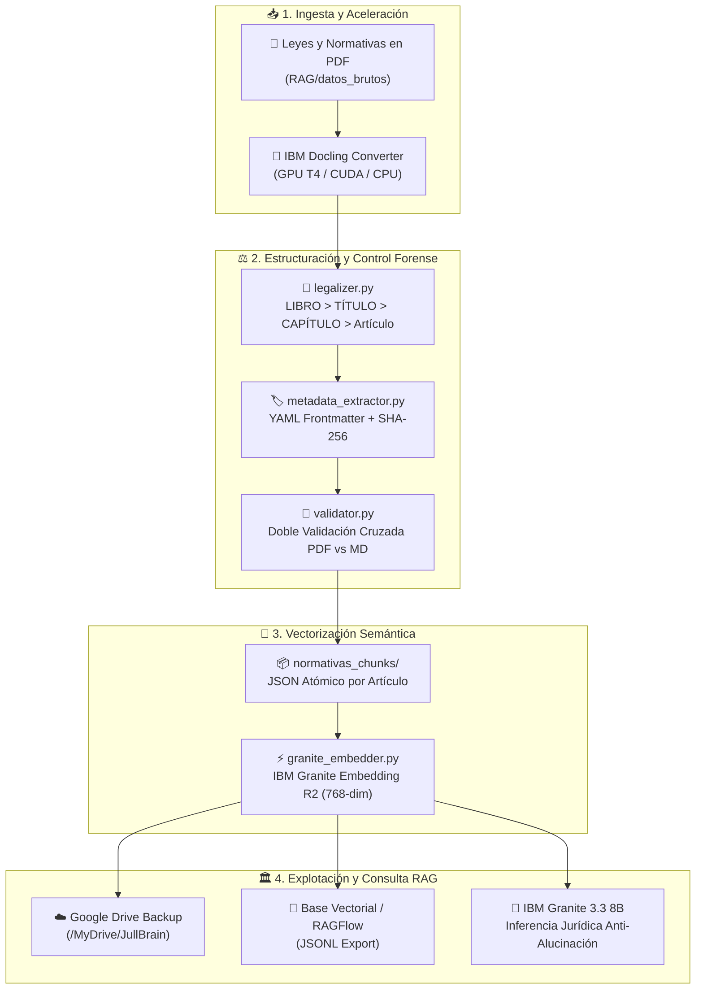

# ⚖️ JullBrain V3.0 — Legal-RAG & Informática Forense

> **Plataforma Enterprise de Inteligencia Documental Legal especializada en normativas, auditoría forense y control judicial venezolano. Operación dual: 100% LOCAL NATIVO OFFLINE (Air-Gapped) y aceleración en la nube con GOOGLE COLAB (GPU NVIDIA T4/A100). Impulsada por IBM Granite 3.3 8B, IBM Docling, Hierarchical Chunking y validación criptográfica SHA-256.**

[](https://colab.research.google.com/github/julljoll/JullBrain/blob/main/JullBrain_Colab.ipynb)
[](https://github.com/julljoll/JullBrain/actions/workflows/colab_sync.yml)
[](https://python.org)
[](LICENSE)
[](https://huggingface.co/ibm-granite)
[](https://github.com/docling-project/docling)
[](#)

---

## 🏛️ Descripción General

**JullBrain V3.0** transforma leyes complejas (Constitución, Códigos Orgánicos, Gacetas Oficiales, Resoluciones y Manuales Forenses) en una base de conocimientos estructurada con estricto control de jerarquía jurídica y cero alucinaciones.

### 🌟 Pilares de la Arquitectura V3.0:

1. **Sincronización Automática GitHub ↔ Google Colab:** Cada cambio subido a GitHub se refleja automáticamente en Google Colab con `git pull` nativo y es verificado de extremo a extremo mediante **GitHub Actions**.
2. **Aceleración en la Nube con GPU NVIDIA Gratuita:** Cuaderno interactivo [`JullBrain_Colab.ipynb`](JullBrain_Colab.ipynb) optimizado para procesar volúmenes masivos de leyes en minutos utilizando GPU T4 o A100.
3. **Operación 100% Local Nativa (Air-Gapped):** Sin dependencias de Docker ni Podman. Corre nativamente en Windows mediante el orquestador `orquestador_JullBrain.bat` garantizando confidencialidad absoluta de la evidencia digital.
4. **Centro de Control Web Unificado (`http://localhost:8050`):** Interfaz visual HTML5/CSS3 con streaming de eventos, consola en tiempo real, subida de documentos y asistente RAG.
5. **Cadena de Custodia Forense Criptográfica:** Sellado inmutable **SHA-256** por expediente y doble validación cruzada PDF vs Markdown (**Principio de Error Cero**).
6. **Ecosistema IBM Granite:** Embeddings densos con `ibm-granite/granite-embedding-311m-multilingual-r2` y guardrails de seguridad con `granite3.1-dense:8b-guardian`.

---

## 🗺️ Diagrama de Arquitectura del Pipeline



---

## 🔄 Sincronización Automática con Google Colab

El sistema está configurado para que cualquier mejora o actualización en el repositorio se propague de forma instantánea:

```
[Desarrollo Local] ─── git push ───► [GitHub: main] ───► [GitHub Actions CI]
                                             │               (Validación automática)
                                             ▼
                                     [Google Colab]
                               (Auto git pull en celda 2)
                                             │
                                             ▼
                                  [Procesamiento con GPU]
                                             │
                                             ▼
                               [Respaldo a Google Drive]
```

1. **En GitHub:** Cada `git push origin main` activa el workflow `.github/workflows/colab_sync.yml`, que comprueba la sintaxis de todos los módulos Python y valida la estructura del notebook.
2. **En Google Colab:** Al abrir el cuaderno [`JullBrain_Colab.ipynb`](https://colab.research.google.com/github/julljoll/JullBrain/blob/main/JullBrain_Colab.ipynb), la celda de inicio ejecuta `git pull origin main`, garantizando que el entorno siempre trabaje con la última versión de los scripts y normativas.
3. **Persistencia en Google Drive:** Los resultados (`normativas_rag`, `normativas_chunks`, vectores) se sincronizan con tu Google Drive (`/content/drive/MyDrive/JullBrain/output_rag`), evitando que se pierdan al expirar la sesión de Colab.

---

## 🚀 Puesta en Marcha Rápida

### Opción A: Modo Local en Windows (Recomendado para uso Offline / Confidencial)

Basta con ejecutar el orquestador:
```cmd
orquestador_JullBrain.bat
```
El orquestador activará el entorno `docling_env` y desplegará el menú interactivo:
* `[1]` Iniciar Centro de Control Web (`http://localhost:8050`)
* `[2]` Conversión Completa con IBM Docling
* `[3]` Verificación QA Cruzada (Principio de Error Cero)
* `[4]` Solo Post-Procesado Legal (Legalizer + Metadata)
* `[5]` Generar Embeddings con IBM Granite R2
* `[6]` Ejecutar Suite de QA Testing Offline
* `[8]` Sincronizar Cambios con GitHub (`git pull origin main`)
* `[9]` Abrir Google Colab en el Navegador

### Opción B: Aceleración en Google Colab con GPU T4 Gratuita

1. Haz clic en el botón superior **[Open In Colab](https://colab.research.google.com/github/julljoll/JullBrain/blob/main/JullBrain_Colab.ipynb)**.
2. En Google Colab, verifica que el entorno esté configurado en GPU:
   * Menú: `Entorno de ejecución` > `Cambiar tipo de entorno de ejecución` > **GPU T4**.
3. Ejecuta el cuaderno celda por celda o presiona `Ctrl + F9` (**Ejecutar todo**).
4. Opcionalmente, monta tu Google Drive para procesar tus propios PDFs y respaldar los resultados.

---

## 🛠️ Estructura del Repositorio

```text
JullBrain/
├── .github/workflows/             # Automatización CI/CD y validación continua
│   ├── colab_sync.yml             # Validación de pipeline y sincronización Colab
│   └── ci_quality.yml             # Pruebas periódicas de integridad documental
├── app.py                         # Backend API REST FastAPI y Servidor Web HTML5
├── web/                           # Interfaz Web Unificada (HTML5, CSS3 Cyber-Legal, JS)
│   ├── index.html                 # Centro de Control, Drag-and-Drop y Consultas RAG
│   ├── styles.css                 # Diseño Dark Mode con acentos dorados y verdes
│   └── app.js                     # Lógica cliente y visualización de logs
├── JullBrain_Colab.ipynb          # Cuaderno oficial para Google Colab con GPU T4/A100
├── colab_runner.py                # Orquestador integral para entorno Google Colab
├── colab_config.json              # Configuración de rutas de Drive, GPU y modelos
├── orquestador_JullBrain.bat      # Lanzador nativo y Centro de Operaciones Windows
├── sincronizar_resultados.py      # Sincronización y sellado criptográfico SHA-256
├── convert_normativas.py          # Ingesta con IBM Docling + Hierarchical Chunking
├── legalizer.py                   # Jerarquía legal venezolana (Libro, Título, Capítulo, Art.)
├── metadata_extractor.py         # Extracción de YAML Frontmatter y SHA-256
├── validator.py                   # Doble validación cruzada PDF vs MD (Error Cero)
├── granite_embedder.py            # Embeddings semánticos con IBM Granite R2 (768-dim)
├── granite_guardian_guardrail.py # Guardrails de seguridad y auditoría de anclaje
├── opensearch_indexer.py         # Motor Híbrido Local (BM25 + Vectores NumPy + RRF)
├── pipeline_config.json           # Configuración técnica persistente del sistema
├── requirements.txt               # Dependencias Python para entorno local
├── requirements_colab.txt         # Dependencias optimizadas para Google Colab GPU
├── tests/                         # Suite de QA Testing (Unit, Integration, Air-Gapped)
│   ├── test_qa_offline.py         # Pruebas de jerarquía, hashes, búsqueda y guardrail
│   ├── test_unit.py               # Pruebas unitarias de endpoints y almacenamiento
│   └── test_integration.py        # Pruebas de integración del pipeline RAG
└── docs/                          # Manuales de Arquitectura, Usuario y Guías Forenses
```

---

## 🧪 Control de Calidad Forense (QA Testing)

Para certificar la integridad y el principio de no alteración de la evidencia digital:

```bash
# Ejecutar suite de pruebas completa
python -m unittest discover tests

# Verificar estado y consistencia SHA-256
python sincronizar_resultados.py --status
python sincronizar_resultados.py --verificar
```

---

## 📄 Licencia

Distribuido bajo la **Licencia Apache 2.0**. Consulte el archivo [LICENSE](LICENSE) para más detalles.
