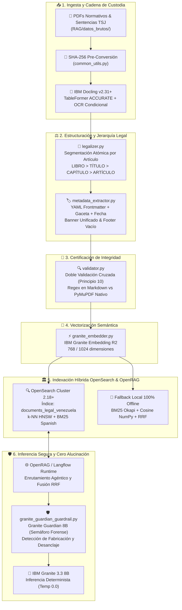

<p align="center">
  
</p>

<h1 align="center">⚖️ JullBrain v0.2.0</h1>
<h3 align="center">Plataforma Legal-RAG Empresarial e Informática Forense (100% Python)</h3>

<p align="center">
  <em>Motor de alta precisión para la transformación de normativas, códigos y expedientes penales venezolanos en conocimiento estructurado de alta fidelidad, optimizado para IBM Docling, IBM Granite (R2 & Guardian), OpenSearch y OpenRAG.</em>
</p>

<p align="center">
  <a href="https://semver.org/"></a>
  <a href="https://python.org"></a>
  <a href="LICENSE"></a>
  <a href="https://huggingface.co/ibm-granite"></a>
  <a href="https://github.com/docling-project/docling"></a>
  <a href="https://opensearch.org/"></a>
  <a href="https://openr.ag/"></a>
  <a href="#"></a>
  <a href="#"></a>
</p>

---

## 📖 Tabla de Contenido

- [¿Qué es JullBrain?](#-qué-es-jullbrain)
- [Principios No Negociables (Cero Alucinación e Informática Forense)](#-principios-no-negociables)
- [Inicio Rápido en 3 Pasos (Guía Fácil)](#-inicio-rápido-en-3-pasos)
- [Cheat Sheet de Comandos CLI (Automatización Directa)](#-cheat-sheet-de-comandos-cli)
- [Flujo de Trabajo Típico: Cómo Procesar Nuevas Normativas](#-flujo-de-trabajo-típico)
- [Arquitectura del Pipeline](#-arquitectura-del-pipeline)
- [Ecosistema Tecnológico IBM + OpenSearch + OpenRAG](#-ecosistema-tecnológico)
- [Despliegue de OpenSearch y OpenRAG](#-despliegue-de-opensearch-y-openrag)
- [Estructura del Repositorio](#-estructura-del-repositorio)
- [Módulos Core y Responsabilidades](#-módulos-core-y-responsabilidades)
- [Control de Calidad (Suite de 23 Tests)](#-control-de-calidad)
- [Licencia y Autor](#-licencia-y-autor)

---

## 🏛️ ¿Qué es JullBrain?

**JullBrain** es una plataforma de ingeniería de datos jurídicos e informática forense especializada en el sistema legal venezolano (Constitución de la República Bolivariana de Venezuela, Códigos Orgánicos, Leyes Especiales, Decretos y jurisprudencia vinculante del Tribunal Supremo de Justicia).

Su objetivo fundamental es transformar documentos PDF complejos, heterogéneos y escaneados en un corpus estructurado de **chunks atómicos a nivel de artículo** con linaje jerárquico inmutable (`LIBRO > TÍTULO > CAPÍTULO > SECCIÓN > ARTÍCULO`) y firmas criptográficas SHA-256, listos para alimentar de forma determinista y segura a modelos de lenguaje como **IBM Granite** a través de **OpenRAG** y **OpenSearch**.

### Operación 100% Terminal
A diferencia de sistemas cargados de interfaces gráficas o dependencias web inestables, JullBrain opera **completamente por consola en Python** mediante el lanzador [`orquestador_JullBrain.bat`](orquestador_JullBrain.bat), garantizando máxima estabilidad, cero consumo innecesario de memoria RAM y ejecución soberana (*air-gapped*).

---

## ⚖️ Principios No Negociables

1. **Chunking Atómico a Nivel de Artículo:** Un chunk representa exactamente un artículo jurídico. Nunca se mezclan normas de leyes distintas ni se fragmentan artículos a la mitad.
2. **Doble Validación Cruzada (Principio de Error Cero):** Todo documento convertido debe ser contrastado mediante dos métodos independientes de conteo: expresiones regulares sobre el Markdown generado frente a extracción nativa de bajo nivel del PDF original con PyMuPDF. Si la discrepancia supera el 2%, se activa alerta forense.
3. **Cero Alucinación & Temperatura 0.0:** Inferencia jurídica determinista (`temp=0.0`, `seed=42`). El sistema tiene prohibido inferir o inventar citas normativas. Si una consulta no encuentra respaldo en el corpus, se aplica la **regla de abstención explícita** (*"No se encontró respaldo en el corpus normativo"*).
4. **Espejo Documental e Integridad SHA-256 (ISO/IEC 27037):** El hash SHA-256 del PDF original se registra en el encabezado YAML frontmatter del Markdown y en cada chunk JSON, asegurando trazabilidad probatoria inmutable.
5. **Guardrails con IBM Granite Guardian:** Todo texto generado o recuperado se somete a auditoría de anclaje normativo (*groundedness*) clasificando riesgos de **fabricación** y **desanclaje** (*misgrounding*) bajo un semáforo forense (`VERDE`, `ÁMBAR`, `ROJO`).

---

## ⚡ Inicio Rápido en 3 Pasos

### Paso 1: Clonar y Preparar el Entorno
Requiere **Python 3.11 o 3.12** instalado en Windows o Linux.

```cmd
:: 1. Clonar el repositorio
git clone https://github.com/julljoll/IBM-DOCLING.git JullBrain
cd JullBrain

:: 2. Crear y activar el entorno virtual
python -m venv docling_env
call docling_env\Scripts\activate

:: 3. Instalar dependencias exactas
pip install -r requirements.txt
```

---

### Paso 2 (Opcional): Iniciar Clúster OpenSearch + OpenRAG
Si deseas almacenar y buscar vectores en el clúster OpenSearch (OpenRAG), inicia los contenedores con un solo clic:

```cmd
:: Enciende OpenSearch (puerto 9200) y OpenRAG (puerto 7860) en segundo plano
iniciar_servicios_openrag.bat
```
*(Si no dispones de Docker/Podman, **JullBrain funciona 100% de forma autónoma** gracias a su motor local offline integrado de Okapi BM25 + similitud coseno con NumPy).*

---

### Paso 3: Ejecutar el Orquestador
Haz **doble clic** en [`orquestador_JullBrain.bat`](orquestador_JullBrain.bat) o ejecútalo en la consola:

```cmd
orquestador_JullBrain.bat
```

Se desplegará el centro de control interactivo en consola Rich:

```text
=========================================================================================
  JullBrain v0.2.0 — CENTRO DE CONTROL LEGAL-RAG (100% PYTHON)
=========================================================================================
  SELECCIONE UNA OPCION DEL CENTRO DE OPERACIONES JULLBRAIN:

    [1] Ver Estado de Archivos Normativos (Tabla RAG de Conversión)
    [2] Convertir UN Archivo Específico (Modo Seguro - 1 por vez)
    [3] Convertir Todos los Archivos Pendientes (Procesamiento Secuencial Seguro)
    [4] Verificación QA de Integridad Cruzada (Validador Cruzado PDF vs MD)
    [5] Generar / Verificar Embeddings Semánticos con Granite R2 e Indexar
    [6] Solo Post-Procesado Legal (Legalizer + Frontmatter YAML)
    [7] Ejecutar Suite Exhaustiva de QA Testing Offline (Air-Gapped)
    [8] Purgar Caché Temporal y Resetear Memoria RAM
    [9] Ver Registro Forense de Auditoría (audit_trail.jsonl)
    [0] Salir
=========================================================================================
```

---

## 🛠️ Cheat Sheet de Comandos CLI

Para entornos automatizados, scripts de tareas programadas o ejecución rápida sin entrar al menú interactivo:

| Tarea a Realizar | Comando Directo por Consola |
|:---|:---|
| **Verificar estado y pruebas** | `cmd /c orquestador_JullBrain.bat --test` |
| **Doble validación cruzada (QA)** | `cmd /c orquestador_JullBrain.bat --qa` |
| **Convertir todos los PDFs pendientes** | `cmd /c orquestador_JullBrain.bat --convert-all` |
| **Convertir un solo PDF en modo seguro** | `cmd /c orquestador_JullBrain.bat --single "RAG/datos_brutos/Penal/copp.pdf"` |
| **Generar embeddings Granite R2** | `cmd /c orquestador_JullBrain.bat --embed` |
| **Indexar masivamente a OpenSearch** | `cmd /c orquestador_JullBrain.bat --opensearch` |
| **Re-ejecutar post-procesado legal** | `cmd /c orquestador_JullBrain.bat --post` |
| **Purgar memoria y archivos temporales** | `cmd /c orquestador_JullBrain.bat --clean` |
| **Consultar bitácora de auditoría forense**| `cmd /c orquestador_JullBrain.bat --audit` |

---

## 📂 Flujo de Trabajo Típico

### 1. ¿Cómo agregar un nuevo documento legal?
1. Copia tu archivo PDF en la carpeta correspondiente dentro de [`RAG/datos_brutos/`](RAG/datos_brutos/) (ejemplo: `RAG/datos_brutos/Penal/nueva_ley.pdf` o `RAG/datos_brutos/Desiciones TSJ 2026/`).
2. Ejecuta `orquestador_JullBrain.bat` y selecciona la opción `[1]` para comprobar que el sistema lo detecte como `[PENDIENTE]`.
3. Selecciona la opción `[2]` para convertir ese archivo individualmente, o la opción `[3]` para procesar todo el lote.

### 2. ¿Dónde se guardan los resultados?
* 📄 **Markdown Estructurado con Frontmatter YAML:** [`RAG/Informacion_docling_rag/`](RAG/Informacion_docling_rag/)
* 📦 **Chunks JSON Atómicos Vectorizados:** [`normativas_chunks/`](normativas_chunks/)
* 📜 **Registro de Auditoría y Cadena de Custodia:** [`audit_trail.jsonl`](audit_trail.jsonl)

---

## 🗺️ Arquitectura del Pipeline



---

## 🧩 Ecosistema Tecnológico

| Capa | Tecnología | Función Específica en JullBrain |
|:---|:---|:---|
| **Motor de Ingesta** | **IBM Docling (≥2.31.0)** | Extracción estructural de PDFs y reconocimiento de tablas de penas con `TableFormer`. |
| **Vectorización** | **IBM Granite Embedding R2** | Modelo denso de 768 / 1024 dimensiones para representación semántica precisa de leyes. |
| **Anti-Alucinación** | **IBM Granite Guardian (8B)** | Guardrail neuronal para certificar que las citas legales provengan estrictamente del contexto. |
| **Inferencia LLM** | **IBM Granite 3.3 8B Instruct** | Generación determinista de dictámenes y respuestas a temperatura 0.0. |
| **Búsqueda Híbrida** | **OpenSearch 2.18+** | Motor de base de datos vectorial (k-NN) combinado con búsqueda léxica BM25 en español. |
| **Orquestación RAG**| **OpenRAG (`langflow-ai`)** | Pila RAG de referencia respaldada por IBM para flujos agénticos y conectores corporativos. |
| **Auditoría Forense** | **ISO/IEC 27037 / SHA-256** | Sellado criptográfico append-only en `audit_trail.jsonl`. |
| **Interfaz Operativa**| **Python Rich Terminal** | Consola profesional con soporte para colores ANSI y tablas dinámicas. |

---

## 🐳 Despliegue de OpenSearch y OpenRAG

El clúster local de OpenSearch y el runtime de OpenRAG están preconfigurados en [`compose.yaml`](compose.yaml):

```bash
# Iniciar servicios en segundo plano:
docker compose up -d

# Comprobar salud del clúster OpenSearch:
curl -s http://localhost:9200

# Detener servicios:
docker compose down
```

Para usuarios en Windows sin comandos de consola, se proporcionan accesos directos de un clic:
* **Iniciar:** [`iniciar_servicios_openrag.bat`](iniciar_servicios_openrag.bat)
* **Detener:** [`detener_servicios_openrag.bat`](detener_servicios_openrag.bat)

---

## 📁 Estructura del Repositorio

```
JullBrain/
├── 🚀 ORQUESTACIÓN Y ENTRADA
│   ├── orquestador_JullBrain.bat     # Lanzador principal Windows (≤ 20 líneas)
│   ├── orquestador.py                # Orquestador terminal 100% Python con consola Rich
│   ├── version.py                    # Fuente única de verdad para SemVer (v0.2.0)
│   ├── compose.yaml                  # Infraestructura Docker: OpenSearch 2.18 + OpenRAG
│   ├── iniciar_servicios_openrag.bat # Script para encender OpenSearch y OpenRAG
│   └── detener_servicios_openrag.bat # Script para detener OpenSearch y OpenRAG
│
├── ⚙️ PIPELINE DE INGENIERÍA LEGAL
│   ├── convert_normativas.py         # Motor principal de conversión con IBM Docling
│   ├── legalizer.py                  # Chunking atómico a nivel de artículo y jerarquía legal
│   ├── metadata_extractor.py         # Extracción de YAML frontmatter, fechas y gacetas
│   ├── validator.py                  # Doble Validación Cruzada (Regex Markdown vs PyMuPDF)
│   ├── common_utils.py               # Módulo centralizado DRY: hashes SHA-256 y regex legales
│   ├── granite_embedder.py           # Embeddings semánticos con IBM Granite R2
│   ├── opensearch_indexer.py         # Búsqueda híbrida (OpenSearch k-NN + BM25 local fallback)
│   ├── granite_guardian_guardrail.py # Guardrail anti-alucinación con semáforo forense
│   ├── audit_logger.py               # Libro mayor inmutable append-only (audit_trail.jsonl)
│   ├── gpu_detector.py               # Detección de hardware (CPU / DirectML / CUDA)
│   └── cleanup.py                    # Purga de archivos temporales y compactación de RAM
│
├── 📂 DATOS Y CORPUS NORMATIVO
│   ├── RAG/datos_brutos/             # 137+ PDFs originales (Leyes, Códigos y Sentencias TSJ)
│   ├── RAG/Informacion_docling_rag/  # Salida Markdown estructurada con YAML frontmatter
│   ├── normativas_chunks/            # Chunks JSON atómicos vectorizados listos para OpenSearch
│   └── audit_trail.jsonl             # Trazabilidad forense inmutable de operaciones
│
├── 🧪 CONTROL DE CALIDAD (QA)
│   └── tests/
│       ├── test_unit.py              # Pruebas unitarias de common_utils, hashing y guardian
│       ├── test_integration.py       # Prueba del flujo completo (Docling -> Legalizer -> Embedder)
│       └── test_qa_offline.py        # Suite exhaustiva de verificación air-gapped y BM25
│
└── 📄 CONFIGURACIÓN Y DOCUMENTACIÓN
    ├── pipeline_config.json          # Configuración centralizada persistente
    ├── requirements.txt              # Dependencias de Python consolidadas
    ├── Dockerfile                    # Contenedor de producción para el pipeline terminal
    ├── LICENSE                       # Licencia Apache 2.0
    └── README.md                     # Manual general del proyecto
```

---

## 🔬 Control de Calidad

JullBrain cuenta con una suite completa de pruebas unitarias y de integración que se ejecutan de manera 100% aislada (*air-gapped*):

```cmd
cmd /c orquestador_JullBrain.bat --test
```

```text
Ran 23 tests in 4.090s
OK (23 passed, 0 failures, 0 errors)
```

Las pruebas certifican:
* **QA-01:** Segmentación atómica y normalización de marcadores de artículos.
* **QA-02:** Integridad forense SHA-256 y detección inmediata de alteraciones (tamper detection).
* **QA-03:** Búsqueda híbrida BM25 + similitud coseno con Fusión Recíproca de Rangos (RRF).
* **QA-04:** Bloqueo de ataques de inyección de prompt (*jailbreak*).
* **QA-05:** Principio de Cero Alucinación y regla de abstención explícita.
* **QA-06:** Validación de integridad normativa y conteo de artículos (conteo PyMuPDF vs Regex).
* **QA-07:** Cerrojazo de red estricto (0 conexiones salientes no autorizadas).

---

## 👨‍⚖️ Autor y Licencia

* **Arquitecto de Datos e Información IA:** Jull Ortiz — Especialista en Legal-RAG e Informática Forense.
* **Licencia del Software:** [Apache License 2.0](LICENSE).
* **Tecnologías Subyacentes:** IBM Docling (Licencia MIT), IBM Granite Models (Licencia Apache 2.0), OpenSearch (Licencia Apache 2.0).

> *"El sistema de inteligencia artificial acelera y asiste, nunca decide ni sustituye el criterio del operador judicial."* (Principio adoptado de la Resolución CNJ n.° 332/2020).
