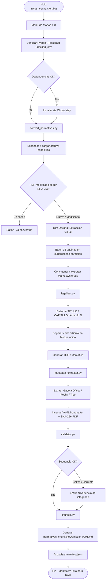

# QUIBOR V-1.0 — Sistema RAG de Normativas Legales Venezolanas

> Sistema RAG Automatizado para Normativas Legales — Powered by IBM Docling

---

## Descripción del Proyecto

**QUIBOR V-1.0** es un pipeline automatizado de grado corporativo que convierte archivos PDF de leyes, decretos y normativas venezolanas en documentos Markdown estructurados, optimizados para sistemas de Inteligencia Artificial (RAG / LLM).

### El problema que resuelve

Los modelos de lenguaje (LLM) y los sistemas RAG fallan cuando consumen PDFs de documentos legales porque:

- Los artículos aparecen fusionados en párrafos de 2,000+ palabras sin separación clara.
- Las tablas de PDFs se rompen o pierden su estructura.
- No hay metadata legal (número de Gaceta, fecha, tipo de instrumento) para filtrar búsquedas.
- El chunking por páginas parte artículos a la mitad, generando fragmentos incoherentes.

### Cómo lo resuelve QUIBOR V-1.0 v2

| Módulo | Función |
|--------|---------|
| **IBM Docling** | Extracción visual profunda del PDF (layout, tablas, OCR) |
| **legalizer.py** | Detecta y separa cada artículo con su jerarquía: TÍTULO › CAPÍTULO › Artículo |
| **metadata_extractor.py** | Genera YAML frontmatter con Gaceta Oficial, fecha, tipo de instrumento, SHA-256 |
| **validator.py** | Verifica secuencia de artículos, detecta saltos y artículos corruptos |
| **chunker.py** | Genera un `.md` individual por artículo para embeddings de precisión máxima |

---

## Tecnologías

- **IBM Docling** — Segmentación visual profunda, extracción de tablas exacta.
- **Tesseract OCR / EasyOCR** — Fallback dual para PDFs e imágenes digitalizadas.
- **Python Rich** — Interfaz de consola avanzada con barras de progreso, paneles y tablas interactivas.
- **Caché SHA-256** — Control inteligente de cambios en archivos de entrada mediante `manifest.json`.
- **YAML Frontmatter** — Metadatos estructurados compatibles con LangChain, LlamaIndex, ChromaDB.

---

## Funciones Avanzadas del Sistema

El convertidor incorpora mecanismos avanzados de nivel corporativo para garantizar alta fidelidad y tolerancia a fallos:

1. **Procesamiento Concurrente por Lotes:** Para PDFs muy extensos, el sistema divide el documento en lotes de **15 páginas** y los procesa en paralelo utilizando un `ThreadPoolExecutor` (máximo de 3 subprocesos paralelos). Esto previene caídas por falta de memoria RAM asociadas a ejecuciones masivas y optimiza los recursos de CPU.
2. **Reintento con Recuperación de Fallos (Fallback sin OCR):** Si un subproceso falla durante la extracción con OCR activo (por ejemplo, debido a errores de Tesseract), el sistema automáticamente realiza un **reintento rápido omitiendo la fase de OCR** en ese lote en lugar de interrumpir la conversión general.
3. **Caché SHA-256 Dinámica:** Cada PDF o imagen procesada se registra en `.conversion_cache/manifest.json` junto con su hash SHA-256 y metadatos. Si un archivo no ha sido modificado, el sistema lo detecta al instante y omite su procesamiento para ahorrar tiempo de ejecución, a menos que se fuerce con `--force-reprocess`.
4. **Soporte Multiformato de Datos:** No solo soporta PDFs. También procesa automáticamente formatos de imagen comunes: **PNG, JPG, JPEG, TIFF y BMP**, los cuales son convertidos directamente a Markdown estructurado y segmentados por artículo.
5. **Suite de Validación de Calidad (validator.py):** Tras la conversión, el validador analiza el documento final e informa sobre:
   - Saltos o vacíos en la secuencia numérica de artículos.
   - Artículos duplicados.
   - Artículos excesivamente cortos (menos de 50 caracteres) indicando posible error de extracción OCR.
   - Presencia de la Tabla de Contenido y el bloque de YAML frontmatter.
6. **Codificación Segura UTF-8 en Windows:** Configura explícitamente el flujo de entrada/salida a UTF-8 para evitar los típicos bloqueos o cuelgues por codificación al procesar caracteres del idioma español (tildes, eñes, diéresis).

---

## Estructura del Proyecto

```
IBM DOCLING/
├── normativas_pdf/          [ENTRADA]  PDFs originales de leyes y normativas
├── normativas_rag/          [SALIDA]   Markdown completo por ley (con YAML + TOC)
├── normativas_chunks/       [SALIDA]   Un .md por artículo (para RAG preciso)
├── .conversion_cache/       [SISTEMA]  Caché SHA-256 + manifest.json de conversiones
├── docling_env/             [SISTEMA]  Entorno virtual de Python (aislado)
│
├── convert_normativas.py    Motor principal: Docling + pipeline legal integrado
├── legalizer.py             Post-procesador: jerarquía legal + separación de artículos
├── metadata_extractor.py    Generador de YAML frontmatter con metadatos legales
├── validator.py             Validador de integridad de artículos
├── chunker.py               Generador de chunks individuales por artículo
└── iniciar_conversion.bat   Orquestador: menú de modos + verificación de requisitos
```

---

## Pipeline Completo



---

## Modos de Ejecución

Al abrir `iniciar_conversion.bat` se presenta un menú interactivo:

| Opción | Modo | Descripción | Argumentos internos |
|--------|------|-------------|---------------------|
| **1** | Conversión completa | Ejecuta Docling con OCR, post-procesado legal completo y generación de chunks por artículo. | *(default)* |
| **2** | Solo post-procesado | Re-aplica la estructuración legal a los archivos `.md` existentes (útil si hay cambios en `legalizer.py` y no se quiere re-correr Docling). | `--post-process-only` |
| **3** | Forzar re-procesado | Ignora por completo la caché de verificación SHA-256 y re-convierte todos los PDFs. | `--force-reprocess` |
| **4** | Conversión rápida sin OCR | Omite el procesamiento OCR. Excelente para PDFs digitales nativos (no escaneados), reduciendo el tiempo de ejecución a la quinta parte. | `--no-ocr` |
| **5** | Procesar un solo archivo | Solicita el nombre de un archivo PDF (ej: `codigo penal.pdf`) y procesa únicamente ese archivo aplicando OCR completo. | `--file-path "nombre.pdf"` |
| **6** | Procesar un archivo s/OCR | Procesa únicamente el archivo PDF especificado, pero omitiendo la fase de OCR (conversión rápida en archivos digitales nativos). | `--file-path "nombre.pdf" --no-ocr` |
| **7** | Conversión sin chunks | Genera el archivo de ley consolidado y legalizado en `normativas_rag/` pero sin dividirlo en artículos individuales. | `--no-chunks` |
| **8** | Validar normativas | Ejecuta de forma independiente la suite de validación de secuencia e integridad en todos los archivos `.md` existentes. | *(ejecuta validator.py)* |

También puedes ejecutar directamente desde la consola del entorno virtual:

```cmd
:: Conversión completa de un único archivo
docling_env\Scripts\python.exe convert_normativas.py --file-path "codigo penal.pdf"

:: Conversión rápida (sin OCR)
docling_env\Scripts\python.exe convert_normativas.py --no-ocr

:: Validar integridad de todos los documentos en la salida
docling_env\Scripts\python.exe validator.py normativas_rag

:: Generar chunks individuales para un documento específico
docling_env\Scripts\python.exe chunker.py "normativas_rag/codigo penal.md"
```

---

## Formato de Salida

### `normativas_rag/` — Markdown completo por ley

Cada archivo tiene:

```markdown
---
tipo_instrumento: "Código"
nombre_oficial: "Código Penal de Venezuela"
gaceta_oficial: "5.494 Extraordinario"
fecha_publicacion: "2000-10-20"
articulos_detectados: 640
categorias: ["penal"]
hash_pdf_sha256: "abc123..."
---

## TÍTULO I - De la aplicación de la Ley Penal

### ÍNDICE DE ARTÍCULOS
| Art. | Descripción | Ubicación |
...

###### Artículo 1 - Principio de Legalidad
Nadie podrá ser castigado por un hecho que no estuviere expresamente
previsto como punible por la ley...

###### Artículo 2 - Retroactividad Favorable
Las leyes penales tienen efecto retroactivo en cuanto favorezcan al reo...
```

### `normativas_chunks/` — Un archivo por artículo

```markdown
---
ley: "Código Penal de Venezuela"
articulo: 1
ubicacion: "TÍTULO I - De la aplicación de la Ley Penal"
gaceta_oficial: "5.494 Extraordinario"
---

# Artículo 1 — Principio de Legalidad
**Ley:** Código Penal de Venezuela
**Ubicación:** TÍTULO I

Nadie podrá ser castigado por un hecho que no estuviere...
```

---

## Instalación y Uso

> [!IMPORTANT]
> **La primera vez requiere ejecutar como Administrador** para instalar dependencias del sistema (Chocolatey, Tesseract OCR).

### Paso 1 — Abrir CMD como Administrador

1. Presiona `Windows`, escribe `cmd`.
2. Clic derecho → **Ejecutar como administrador**.

### Paso 2 — Navegar al proyecto y ejecutar

```cmd
cd /d "D:\VS CODE\IBM DOCLING"
iniciar_conversion.bat
```

### Paso 3 — Seleccionar modo y confirmar

El menú mostrará las 8 opciones. Selecciona con el número correspondiente, presiona Enter y sigue las instrucciones en pantalla.

---

## Automatización en Windows

### Tarea programada (recomendado)

1. Abre el **Programador de tareas** de Windows.
2. Selecciona **Crear tarea básica** > dale un nombre (ej: `QUIBOR-RAG`).
3. Desencadenador: **Al iniciar sesión** o la frecuencia que necesites.
4. Acción: **Iniciar un programa** → selecciona `iniciar_conversion.bat`.
5. En **Iniciar en**: `D:\VS CODE\IBM DOCLING`

---

## Resultados de la Version Actual

Procesando los documentos legales venezolanos incluidos:

| Documento | Artículos detectados | Chunks generados |
|-----------|---------------------|-----------------|
| Código Penal | 640 | 629 |
| Código Orgánico Procesal Penal | 355 | 353 |
| Ley Especial de Delitos Informáticos | 35 | 35 |
| Ley sobre Mensajes de Datos | 56 | 55 |
| Creación del CENIF | 74 | 74 |
| Ley-sobre-Mensajes-de-Datos-y-Firmas-Electrónicas | 56 | 55 |

> [!NOTE]
> Los documentos ISO/NIST usan numeración por secciones (no por "Artículo N"). Se detectan correctamente pero sin separación de artículos. Próxima mejora: soporte de secciones numeradas.

---

## Licencia y Desarrollador

**Licencia MIT** — Libre uso, modificación y distribución.

| | |
|--|--|
| **Desarrollador** | Jull Ortiz (Arquitecto de Información IA y bases de datos vectoriales) |
| **Correo** | julljoll@gmail.com |
| **Web** | [sha256.us](https://sha256.us) |
| **Instagram** | [@sha256.us](https://www.instagram.com/sha256.us/) |
| **Propósito** | Transformación tecnológica del sistema de justicia venezolano |
| **Copyright** | (C) 2026 Jull Ortiz |

*Desarrollado con dedicación para acelerar y fortalecer la digitalización jurídica de Venezuela.*
