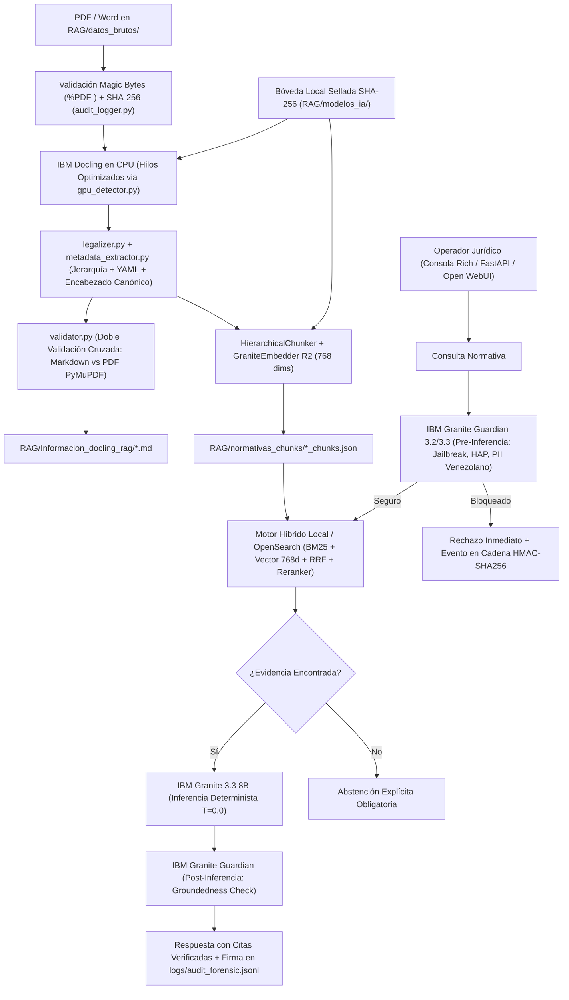
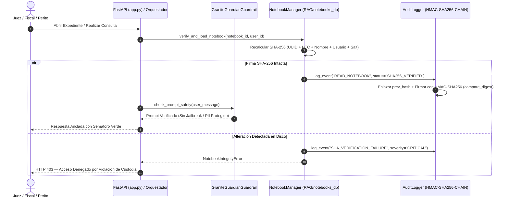

# Diagramas UML y de Arquitectura — JullBrain v0.2.0 (Stack IBM)

---

## 📐 1. Diagrama de Ingesta Documental, Bóveda Local y Pipeline RAG (Mermaid)

---

## 🏛️ 2. Diagrama de Secuencia: Cadena de Custodia `SHA-256` y `HMAC-SHA256-CHAIN`

