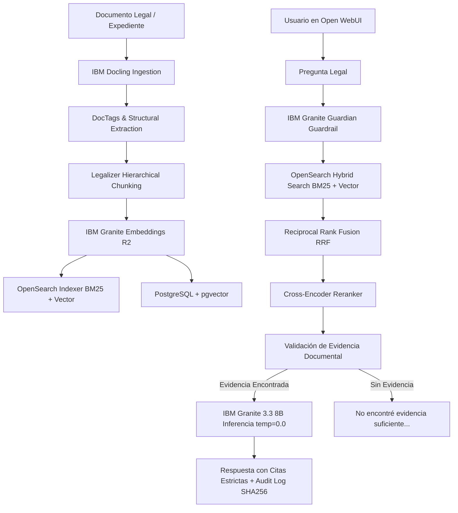
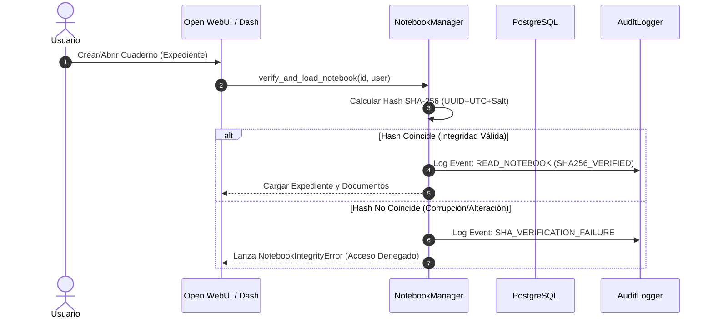

# Diagramas UML y de Arquitectura — JullBrain Enterprise

---

## 📐 1. Diagrama de Ingesta Documental y RAG Pipeline (Mermaid)

---

## 🏛️ 2. Diagrama de Secuencia de Gestión de Cuadernos (SHA-256)

